# 🍽️ Essensplaner für Home Assistant

Ein Essensplaner mit **176 Rezepten (auch Fertiggerichte, Beilagen, Desserts und Getränke), Wochenplan, Kochmodus, Einkaufsliste mit Preisen, Wochenbudget, den Angeboten deiner Läden, Kassenzetteln und deinen Läden (Hauptladen + Ausnahmen, auch Drogerien wie Rossmann oder dm)**, im Stil von Apps wie Piatto, aber komplett lokal in Home Assistant und **per Sprache bzw. Chat über „Jarvis“ (oder jeden anderen Assist- bzw. LLM-Agenten) steuerbar**.

> „Hey Jarvis, was gibt es heute zu essen?“ · „Plane mir die Woche günstig.“ · „Welche Angebote gibt es diese Woche?“ · „Wie viel Budget habe ich noch?“ · „Was kann ich mit Hähnchen und Reis kochen?“ · „Erstelle die Einkaufsliste.“ · „Was muss ich bei Aldi kaufen?“ · „Was kaufe ich bei Rossmann?“ · „Wo ist Butter am günstigsten?“

**Inhalt:** [Funktionen](#funktionen) · [Installation](#installation) · [Einstellungen](#️-einstellungen) · [Jarvis](#-jarvis--andere-sprachassistenten) · [Dashboard-Karte](#️-dashboard-karte) · [Preise, Budget & Angebote](#-preise-budget--angebote) · [Läden, Filialen & Preise](#-läden-filialen--preise) · [Angebote deiner Läden](#️-angebote-deiner-läden) · [Anlässe & Getränke](#-anlässe--getränke) · [Kassenzettel](#-kassenzettel) · [Datenschutz](#-datenschutz) · [Blueprints](#-blueprints) · [Entitäten](#entitäten) · [Aktionen](#aktionen-services)

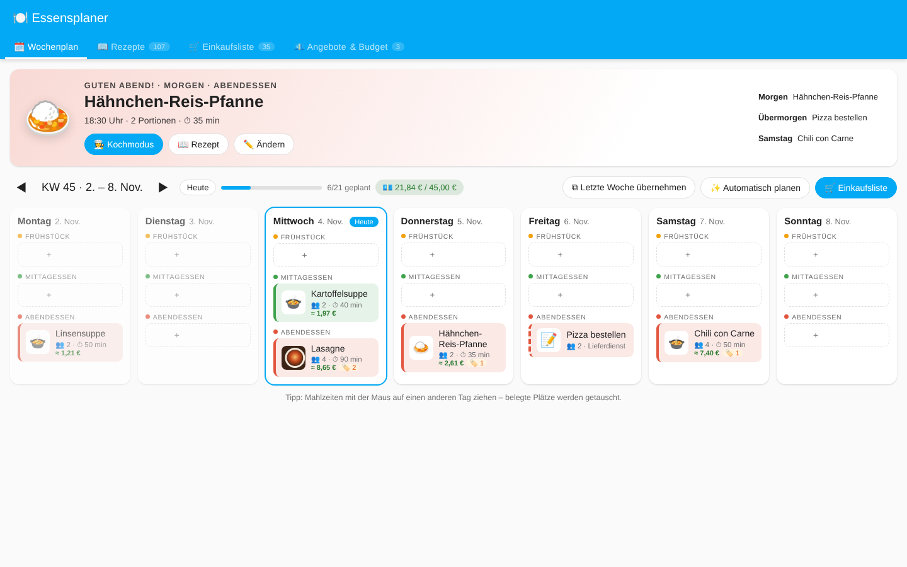

## Funktionen

| Bereich | Was es kann |
|---|---|
| 📖 **Rezepte** | Eigene Rezepte mit Zutaten, Schritten, Zeiten, Kategorien, Bild, Favoriten und ⭐ Bewertung. **Import per Link** von Chefkoch, Lecker, Eat Smarter, BBC Good Food & allen Seiten mit schema.org-Rezepten. Portionen werden automatisch umgerechnet. Sortieren nach „günstigste“, „zuletzt gekocht“, „schnellste“, „beste Bewertung“ … **176 Rezepte** zum Start (Klassiker, vegetarisch/vegan, Suppen, Pasta, international, Fisch, Frühstück, Kuchen, **25 Fertiggerichte** wie TK-Pizza, Maultaschen oder Ravioli aus der Dose und Beilagen, Vorspeisen, Desserts, Grill- und Festessen und Getränke für [Anlässe](#-anlässe--getränke)). **Export/Import** als JSON. |
| 🗓️ **Wochenplan** | Frühstück, Mittag, Snack und Abendessen, mit Rezept oder Freitext („Pizza bestellen“), Kosten je Mahlzeit. **Drag & Drop** (belegte Plätze werden getauscht), **„Letzte Woche übernehmen“**, Woche **automatisch planen** – *ausgewogen*, *günstig* (Budget), *Angebote nutzen*, *Abwechslung* oder *saisonal*: Favoriten, lange nicht Gekochtes und **was gerade Saison hat** (Kürbis, Spargel, Grünkohl, Advent, Grillzeit …) werden bevorzugt, ähnliche Gerichte an aufeinanderfolgenden Tagen und „Nie vorschlagen“-Zutaten vermieden; optional **🤖 mit KI**. |
| 💶 **Preise & Budget** | Richtpreise für über 300 Zutaten (auch Getränke, Tiefkühlkost, Snacks und Grillzubehör), eigene Preise – auch **je Laden** (Preisliste Aldi, Lidl, REWE … nebeneinander), die **echten Preise deiner Kassenzettel**, **gelernte Normalpreise** aus Prospekten mit Verlauf, optional REWE- und ALDI-SÜD-Onlinepreise (experimentell). Preise einer Kette werden nie auf eine andere übertragen. Kosten pro Rezept/Portion/Woche, **Wochenbudget** mit Restbudget. |
| 🏪 **Läden & Filialen** | Deine Filialen per **OpenStreetMap-Suche** rund um Zuhause und Arbeit, **auf dem Arbeitsweg** oder von Hand – Supermärkte und **Drogerien (Rossmann, dm, Müller, Budni)**. **Hauptladen + Ausnahmen**: alles in den Hauptladen, nur Angebote und deutlich günstigere Artikel in andere Läden, Drogerieartikel in deine Drogerie. |
| 🏷️ **Angebote** | **Alle aktuellen und kommenden Angebote deiner Läden** – EDEKA (dein Markt) und ALDI SÜD direkt von den Ketten, Lidl, REWE, Penny, Netto, Kaufland, Rossmann, dm … optional über marktguru.de (auf eigenes Risiko), bei NORMA die Prospektseiten als Bilder – oder selbst eingetragen. **📰 Prospekte aller Filialen** (aktuelle und nächste Woche, mit marktguru als Seitenbilder, sonst als Link zur Kette). Passende Angebote fließen in Rezeptkosten, Planung und Einkaufsliste ein. „➕ Auf die Einkaufsliste“ direkt vom Angebot. |
| 🎉 **Anlässe & Getränke** | Filmabend, Grillabend, Familienessen, Weihnachtsessen, Silvester, Geburtstag, Brunch, Raclette, Fondue, Party oder Osteressen als **eigener Anlass** im Wochenplan: Gänge mit Rezepten, Produkten oder Freitext, **Zubehör je Gäste** (Grillkohle, Popcorn, Servietten …), passende **Getränke mit und ohne Alkohol** (alkoholfreie immer dabei, Mengen je Gäste), Kosten, eigene Einkaufsliste, Kalender-Termin und Sensor „Nächster Anlass“. Vorschläge nach Regeln, optional mit KI. |
| 🧾 **Kassenzettel** | Text des Kassenzettels einfügen (lokal gelesen) oder Foto/PDF von deiner KI-Aufgabe lesen lassen, prüfen – und die Preise werden **eigene Preise des Ladens** (mit Datum und Verlauf). |
| 👩‍🍳 **Kochmodus** | Vollbild Schritt für Schritt mit großer Schrift, Zutaten zum Abhaken, **Timer aus dem Rezepttext** („15 Minuten köcheln“ → ⏱ mit Signalton). Der Bildschirm bleibt an. Blättern per Wischen oder Pfeiltasten. |
| 🧊 **Was kann ich kochen?** | Rezepte zu den Zutaten, die du da hast, mit Angabe, was noch fehlt. |
| 🛒 **Einkaufsliste** | Wird aus dem Plan erzeugt: Zutaten werden **zusammengefasst** (500 g + 0,7 kg → 1,2 kg), auf Portionen skaliert, **nach Supermarkt-Abteilung sortiert**, Vorratszutaten (Salz, Pfeffer …) weggelassen. Abgehakte Einträge bleiben beim Neuerstellen abgehakt. **Preis je Artikel und Gesamtsumme**, Angebots-Hinweise („🏷️ Lidl 4,99 €“), **nach Laden** mit Zwischensumme oder nach Abteilung, **Ladenwahl je Artikel**, **Artikelsuche beim Tippen** (Preis, Packung, Angebot), **Liste leeren**, Fortschrittsbalken, Teilen (Teilen-Menü des Geräts) bzw. Kopieren als Text, optional Kopie in eine andere To-do-Liste (z. B. Bring!). |
| 🗣️ **Jarvis / Assist / LLM** | 28 Intents, die automatisch als **Tools für LLM-Agenten** (inkl. MCP-Server) erscheinen, plus deutsche Sätze für den eingebauten Sprachagenten. |
| 📱 **App in der Seitenleiste** | Panel „Essensplaner“ mit Heute-Karte, Wochenplan, Rezepten, Einkaufsliste, Angeboten, „🏪 Läden & Preise“ und allen **Einstellungen (⚙️)**, passend zu Hell/Dunkel-Theme und Handy. |
| 🖼️ **Dashboard-Karte** | `custom:essensplaner-card` (Heute · Nächste Mahlzeit · Woche), ideal fürs Küchen- oder Esszimmer-Tablet. |
| 🏠 **Entitäten & Blueprints** | Sensoren, Kalender, To-do-Liste und Buttons, dazu fertige Blueprints für Essens-Erinnerung und Wochen-Routine. |

| Angebote & Budget | Rezept mit Kosten & Angebot |
|---|---|
| 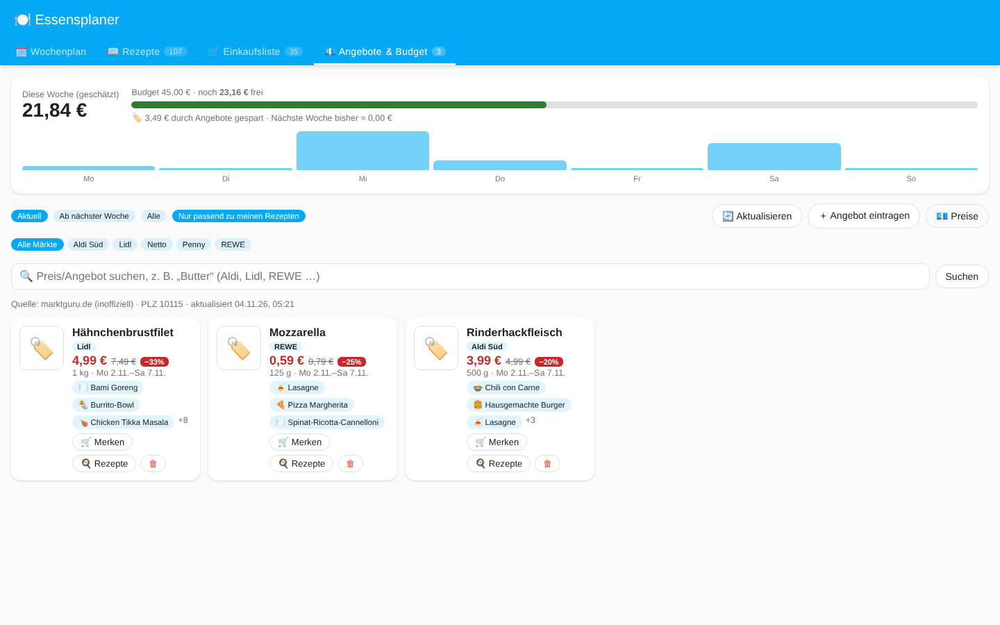 | 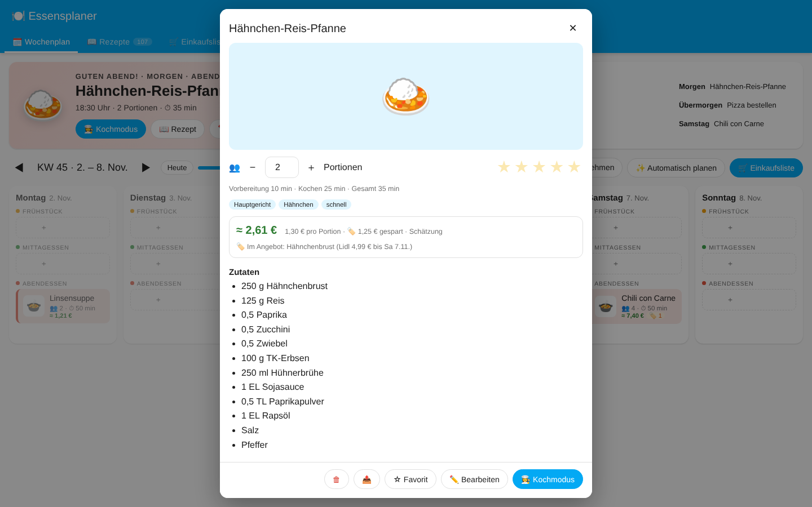 |

| Kochmodus | Was kann ich kochen? |
|---|---|
| 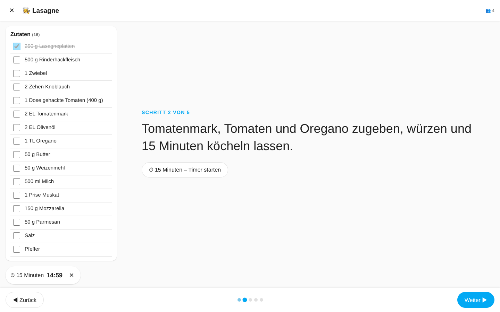 | 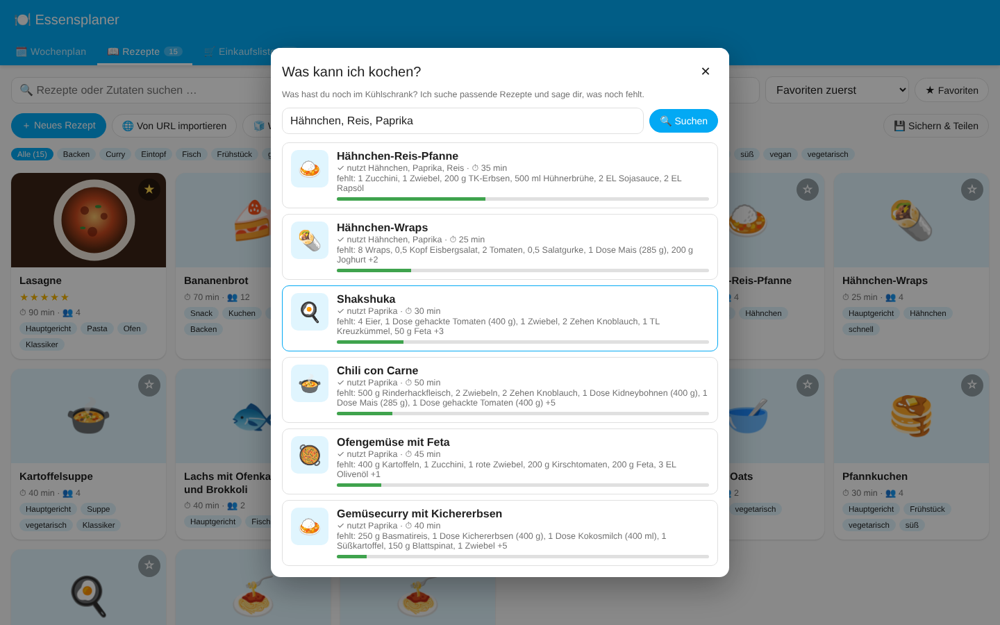 |

| Rezepte | Handy | Einkaufsliste |
|---|---|---|
| 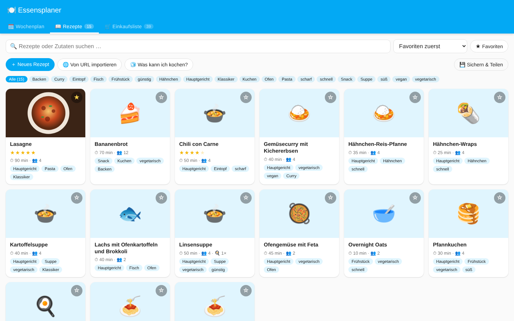 | 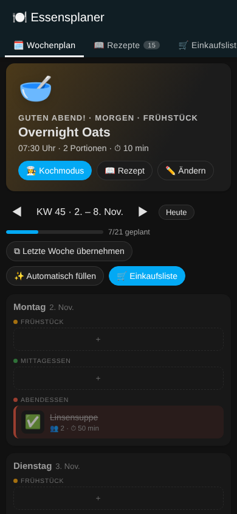 | 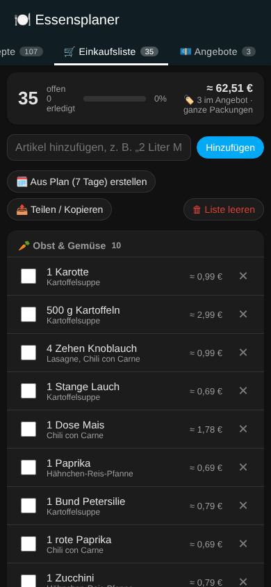 |

## Installation

### HACS (empfohlen)
1. HACS → ⋮ → **Benutzerdefinierte Repositories** → `https://github.com/tollzockt/HA-Essens-planer-`, Typ **Integration**.
2. „Essensplaner“ installieren und Home Assistant neu starten.
3. **Einstellungen → Geräte & Dienste → Integration hinzufügen → Essensplaner** (Beispielrezepte und Portionen wählen).
4. Alles Weitere stellst du im Panel **Essensplaner** über das **⚙️-Zahnrad oben rechts** ein – siehe [Einstellungen](#️-einstellungen).

### Manuell
Ordner `custom_components/essensplaner` nach `/config/custom_components/essensplaner` kopieren, neu starten, Integration hinzufügen.

### Updates
HACS installiert **GitHub-Releases**, nicht einfach den neuesten Stand des Repositorys. Für jede neue Version wird deshalb ein Release mit dem Tag `vX.Y.Z` erstellt – für diese Version **`v1.4.0`**. Dann erscheint das Update unter *Einstellungen → Updates* bzw. in HACS (falls es nicht von selbst auftaucht: in HACS beim Essensplaner über ⋮ die Informationen aktualisieren). Danach Home Assistant neu starten und den Browser einmal neu laden (Strg+F5 bzw. App-Cache leeren).

### Update auf 1.4
- **Deine Daten und Einstellungen bleiben erhalten.** Eine Drogerie, die du in 1.3 notgedrungen als andere Kette gespeichert hast (z. B. „ROSSMANN Drogeriemarkt“ als Marktkauf), wird beim ersten Start automatisch auf die richtige Kette umgestellt – samt eigener Preise und „immer hier“.
- **Die Einstellungen sind ins Panel umgezogen** (⚙️ oben rechts). *Einstellungen → Geräte & Dienste → Essensplaner → Konfigurieren* blendet nur noch das Panel in der Seitenleiste ein oder aus.
- Die neuen Quellen (EDEKA-Angebote, ALDI-SÜD-Preise, KI-Aufgabe für Kassenzettel) sind **aus**, bis du sie einschaltest. Hattest du marktguru schon an, bleibt es an – mit dem neuen [Hinweis zu den AGB](#️-angebote-deiner-läden); es lädt jetzt je Kette den ganzen Prospekt statt einer Suche je Zutat (viel weniger Anfragen).
- Nutzt du den eingebauten Sprachagenten ohne LLM, kopiere [`custom_sentences/de/essensplaner.yaml`](custom_sentences/de/essensplaner.yaml) erneut (neue Ketten Rossmann, dm, Müller, Budni).
- Kommst du von 1.2: Eigene Preise mit Laden landen zusätzlich in der Preisliste dieses Ladens; bis du Filialen anlegst, verhält sich alles wie in 1.2. **Achtung:** Mit der Sätze-Datei landet „Setz Milch auf die Einkaufsliste“ (und jede andere Formulierung von Home Assistants eingebauter Einkaufsliste) auf der Essensplaner-Liste statt auf der eingebauten Einkaufsliste bzw. einer damit synchronisierten Liste (z. B. Bring!), siehe [Eingebauter Sprachagent](#eingebauter-sprachagent-ohne-llm).
- Zurück auf eine ältere Version geht nur mit einem Backup von vorher (die Daten werden beim Update umgestellt).

## ⚙️ Einstellungen

Alle Einstellungen findest du im Panel **Essensplaner** über das **⚙️-Zahnrad oben rechts** – am Handy als ganze Seite, am PC als großes Fenster. Jedes Feld hat eine kurze Erklärung, Fehler stehen direkt am Feld (die Bereiche links zeigen, wo noch etwas fehlt). Gespeichert werden nur geänderte Werte; danach lädt der Essensplaner neu (ein paar Sekunden) und das Panel verbindet sich von selbst wieder. Ändern dürfen nur **Administratoren** – für andere Benutzer ist das Zahnrad ausgegraut.

| Einstellungen | Handy |
|---|---|
| 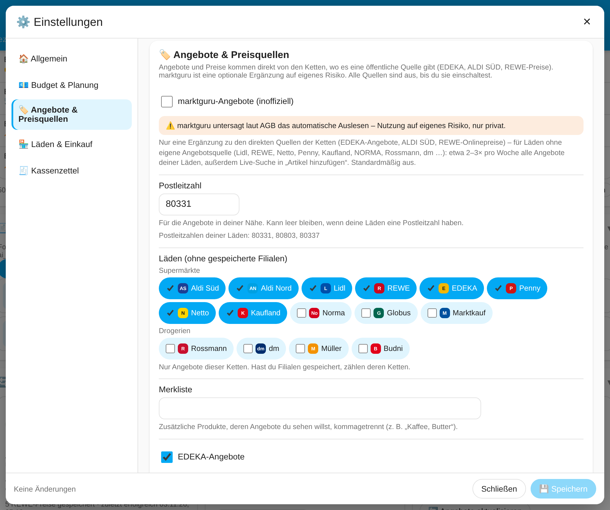 | 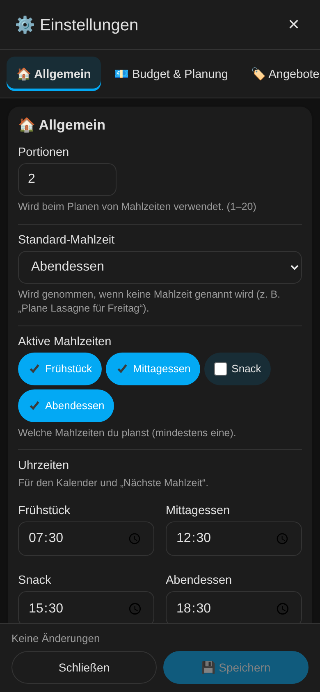 |

| Bereich | Einstellungen (Standard) |
|---|---|
| 🏠 **Allgemein** | Portionen (2), Standard-Mahlzeit (Abendessen), aktive Mahlzeiten und ihre Uhrzeiten (für Kalender und „Nächste Mahlzeit“), **Vorratszutaten** (kommen nie auf die Einkaufsliste), **ausgeschlossene Zutaten** („Nie vorschlagen“, z. B. „Fisch, Pilze“), automatisch als gekocht markieren (an), Einkaufsliste zusätzlich in eine andere To-do-Liste kopieren (z. B. Bring!), Sprachbefehle registrieren (an), Panel in der Seitenleiste (an) |
| 💶 **Budget & Planung** | Wochenbudget (0 = kein Budget), Planungsart: ausgewogen · günstig · Angebote nutzen · Abwechslung · saisonal; Saison berücksichtigen (an – siehe [Saison & Fertiggerichte](#-saison--fertiggerichte)), Anlässe im Wochenbudget (an), Getränkevorschläge mit Alkohol (an – alkoholfreie sind immer dabei) |
| 🏷️ **Angebote & Preisquellen** | **EDEKA-Angebote** (aus), **ALDI-SÜD-Preise** (experimentell, aus), **REWE-Onlinepreise** (experimentell, aus), **marktguru-Angebote** (aus, inoffiziell, eigenes Risiko – der AGB-Hinweis steht direkt am Schalter), Prospekte aller Filialen (an, nur mit marktguru), Postleitzahl, Läden ohne gespeicherte Filialen, Merkliste |
| 🏪 **Läden & Einkauf** | Aufteilungsmodus: Aus – eine Liste wie bisher · Alles im Hauptladen · Hauptladen + Ausnahmen (Standard); Schwellen (woanders günstiger ab 1,00 € oder 20 %, Angebot ab 0,30 €, Extra-Laden ab 0 € = aus); Zonen (leer = Zuhause und „Arbeit“-Zonen), Umkreis (3 km), Arbeitsweg (an, 800 m daneben) für die Filialsuche |
| 🧾 **Kassenzettel** | KI-Aufgabe für Kassenzettel-Fotos (keine – dann die KI aus „🤖 KI“, wenn sie eine KI-Aufgabe ist, sonst nur eingefügter Text) |
| 🤖 **KI** | KI-Aufgabe oder Gesprächsagent aus Home Assistant (keine), wofür die KI genutzt wird (Anlässe, Getränke, Saisonplan, Kassenzettel-Fotos an; Produktzuordnung aus), „Verbindung testen“ – siehe [KI über Home Assistant](#-ki-über-home-assistant-optional) |

Die Filialen selbst, den Hauptladen, die Markt-IDs (REWE, EDEKA) und die ALDI-SÜD-Filiale wählst du im Tab **„🏪 Läden & Preise“**. Hinweise im Panel („Einschalten: ⚙️ Angebote & Preisquellen“) öffnen die Einstellungen direkt am richtigen Bereich.

**Der Dialog von Home Assistant** (*Einstellungen → Geräte & Dienste → Essensplaner → Konfigurieren*) hat seit 1.4 nur noch einen Schalter: **„Panel in der Seitenleiste anzeigen“**. So kommst du jederzeit wieder an die Einstellungen, auch wenn du das Panel ausgeschaltet hast; alle anderen Einstellungen bleiben beim Speichern dort unverändert. Die Einrichtung (Beispielrezepte, Portionen) ist gleich geblieben.

Für eigene Oberflächen: die Websockets `essensplaner/get_settings` (Werte, Standardwerte, Bereiche, Auswahllisten und Hinweise) und `essensplaner/save_settings` (`values`; prüft alle Werte und antwortet mit `errors` je Feld oder `saved`/`reload`), dazu `essensplaner/ai_status` (gewählte KI, Art, erreichbar, Funktionen) und `essensplaner/ai_test` (optional `entity_id`; Ergebnis `ok`, Sekunden oder `error`) – alle nur für Administratoren.

### 🤖 KI über Home Assistant (optional)

Der Essensplaner funktioniert **komplett ohne KI** – Vorschläge, Planung, Preise und Einkaufsliste laufen nach festen Regeln. Wer mag, lässt eine KI zusätzlich Vorschläge ordnen oder ergänzen (z. B. ein Menü für einen Anlass oder passende Getränke). Die KI läuft **über Home Assistant**, der Essensplaner speichert **keine API-Schlüssel**:

1. In Home Assistant eine KI-Integration einrichten (*Einstellungen → Geräte & Dienste → Integration hinzufügen*), z. B. **Anthropic** (Claude), **OpenAI** (GPT), **Google Generative AI** (Gemini) oder **Ollama** (lokal auf deinem Rechner oder mit Ollama-Cloud-Modellen). Sie bringt eine **KI-Aufgabe** (`ai_task.…`) und/oder einen **Gesprächsagenten** (`conversation.…`) mit; auch ein eigener Agent wie Jarvis/Hermes geht.
2. Im Panel **⚙️ → 🤖 KI** die KI wählen (KI-Aufgaben und Gesprächsagenten, jeweils mit „nicht erreichbar“, falls sie gerade nicht verfügbar sind), die Funktionen an- oder abhaken und **„Verbindung testen“** – das schickt eine winzige Anfrage und zeigt, ob und wie schnell eine Antwort kommt (auch vor dem Speichern).

Gut zu wissen:

- **Kassenzettel-Fotos** brauchen eine **KI-Aufgabe**, die Bilder lesen kann – ein Gesprächsagent bekommt keine Bilder. Unter ⚙️ → Kassenzettel kannst du dafür eine eigene KI-Aufgabe wählen; leer bleibt die KI aus „🤖 KI“ zuständig, wenn sie eine KI-Aufgabe ist.
- Eine Anfrage nach der anderen (bis zu 2 Minuten, eine lokale KI auf einem kleinen Rechner braucht Zeit); dieselbe Anfrage wird 10 Minuten lang nicht noch einmal gestellt. Jede Anfrage an einen Gesprächsagenten ist ein neues Gespräch.
- **Keine Schleifen:** Jede Anfrage endet mit „Benutze keine Werkzeuge. Antworte nur mit JSON.“, und ruft der Agent während einer Essensplaner-Anfrage trotzdem ein Essensplaner-Tool auf, lehnt der Essensplaner ab – ein Agent wie Jarvis ruft sich so nicht selbst wieder auf. (Agenten außerhalb von Home Assistant, die per MCP zugreifen, kann der Essensplaner keiner Anfrage zuordnen; für sie gilt die Anweisung im Text.) Umgekehrt fragen die Sprachbefehle nie selbst die KI (Jarvis ist ja schon eine).
- **Was die KI bekommt:** nur Rezeptnamen, Tags und Zutaten, Kettennamen (keine Filialen, Adressen oder Postleitzahlen), Angebotspreise, Monat/Saison, Gästezahl und ausgeschlossene Zutaten – nie Notizen, Kassenzettel-Texte oder Namen. Ist die KI ein Cloud-Dienst, geht das an diesen Anbieter; eine lokale KI wie Ollama bleibt im Haus. KI-Antworten werden gegen deine Rezepte geprüft und nie ungefragt übernommen.

## 🤖 Jarvis & andere Sprachassistenten

Der Essensplaner registriert **Intents**. Home Assistant stellt jeden registrierten Intent über die *Assist*-LLM-API automatisch als **Tool** bereit:

* **LLM-Agenten** (OpenAI, Anthropic, Google, Ollama, Hermes …) mit aktivierter Option „Home Assistant steuern → Assist“ sehen die Tools sofort.
* Der **Model-Context-Protocol-Server** (Integration „MCP Server“ mit LLM-API *Assist*) gibt die Tools an externe Agenten weiter, z. B. an **Jarvis/Hermes-Agent**, Claude Desktop & Co.
* Für den **eingebauten Agenten** ohne LLM gibt es fertige deutsche Sätze (siehe unten).

### Empfohlene Einrichtung für Jarvis
1. Integration installieren (Intents sind standardmäßig aktiv, Einstellung „Sprachbefehle registrieren“ unter ⚙️ → Allgemein).
2. Unter **Einstellungen → Sprachassistenten → Entitäten freigeben** diese Entitäten für Assist freigeben, damit Jarvis den Plan auch „sieht“:
   `sensor.essensplaner_today`, `sensor.essensplaner_tomorrow`, `sensor.essensplaner_next_meal`, `sensor.essensplaner_week_plan`, `todo.essensplaner_shopping_list`, `calendar.essensplaner_meal_plan` – für den Einkauf nach Laden `sensor.essensplaner_shopping_stores` und `sensor.essensplaner_shopping_total`, für Anlässe `sensor.essensplaner_next_occasion`.
3. Fertig. Wenn Jarvis über den MCP-Server auf Home Assistant zugreift, tauchen die Tools `essensplaner_*` nach einem Neuladen der Tool-Liste auf.

Optional im System-Prompt des Agenten: *„Für Fragen zu Essen, Rezepten, Wochenplan und Einkaufsliste nutze die Tools `essensplaner_*`.“*

### Tools / Intents

| Tool | Beispiel |
|---|---|
| `essensplaner_get_meals` | „Was gibt es heute/morgen Abend/am Freitag zu essen?“ |
| `essensplaner_get_week_plan` | „Wie sieht der Essensplan diese Woche aus?“ |
| `essensplaner_plan_meal` | „Plane Lasagne für Freitag zum Abendessen.“ |
| `essensplaner_move_meal` | „Verschiebe die Lasagne auf Samstag.“ · „Tausche Montag und Dienstag.“ |
| `essensplaner_remove_meal` | „Lösche das Essen von morgen.“ |
| `essensplaner_suggest_recipes` | „Was soll ich heute kochen?“ · „Schlag mir was Schnelles vor.“ |
| `essensplaner_cook_with` | „Was kann ich mit Hähnchen, Reis und Paprika kochen?“ |
| `essensplaner_get_recipe` | „Was brauche ich für Chili con Carne für 6 Personen?“ · „Lies mir das Rezept vor.“ |
| `essensplaner_search_recipes` | „Welche Rezepte habe ich mit Hähnchen?“ |
| `essensplaner_create_shopping_list` | „Erstelle die Einkaufsliste für die Woche.“ |
| `essensplaner_get_shopping_list` | „Was steht auf der Einkaufsliste?“ · „Was muss ich einkaufen?“ · „Was muss ich bei Aldi kaufen?“ · „Was kaufe ich im Hauptladen?“ · „Was kaufe ich bei Rossmann?“ |
| `essensplaner_add_shopping_item` | „Setz Butter auf die Einkaufsliste.“ · „Füge Kaffee zur Einkaufsliste hinzu.“ (mit Preis, Laden und deinem ⭐ Lieblingsprodukt) |
| `essensplaner_set_shopping_store` | „Kauf die Butter bei REWE.“ · „Milch kaufe ich immer bei Lidl.“ · „Was kaufe ich immer bei Lidl?“ |
| `essensplaner_compare_prices` | „Wo ist Butter am günstigsten?“ · „Vergleiche die Preise für Hackfleisch.“ (nur echte Preise deiner Läden mit dem Produkt dahinter; ein Richtwert wird als solcher gesagt) |
| `essensplaner_clear_shopping_list` | „Lösche die Einkaufsliste.“ · „Entferne die erledigten Einträge.“ |
| `essensplaner_auto_plan` | „Plane mir die nächste Woche (vegetarisch).“ · „Plane die Woche günstig / mit den Angeboten / saisonal.“ |
| `essensplaner_get_offers` | „Welche Angebote gibt es diese Woche?“ · „Wo ist Butter im Angebot?“ · „Was ist im Hauptladen im Angebot?“ · „Wo ist Butter bei Lidl Arbeit im Angebot?“ · „Was hat Rossmann im Angebot?“ · „Was gibt es in der Drogerie im Angebot?“ |
| `essensplaner_add_offer` | „Bei Lidl gibt es Hähnchenbrust für 4,99 Euro das Kilo bis Samstag.“ (befristetes Angebot) |
| `essensplaner_set_price` | „Butter kostet bei Netto 1,79 Euro.“ · „Merk dir: Milch kostet bei Lidl 99 Cent.“ (Normalpreis des Ladens, bleibt) |
| `essensplaner_get_costs` | „Was kostet der Essensplan diese Woche?“ · „Wie viel Budget habe ich noch?“ |
| `essensplaner_add_recipe` | „Speichere ein Rezept Rührei mit 3 Eiern, Butter und Salz.“ |
| `essensplaner_import_recipe` | „Importiere das Rezept von https://www.chefkoch.de/…“ |
| `essensplaner_mark_cooked` | „Wir haben heute Linsensuppe gekocht.“ |
| `essensplaner_plan_occasion` | „Plane einen Filmabend am Samstag für 4.“ · „Plane ein Weihnachtsessen an Heiligabend für 8 Personen.“ (Menü, Getränke und Zubehör nach Regeln) |
| `essensplaner_get_occasion` | „Was gibt es Weihnachten?“ · „Was gibt es beim Grillabend?“ · „Wann ist der nächste Anlass?“ |
| `essensplaner_edit_occasion` | „Füge Kartoffelsalat zum Grillabend hinzu.“ · „Streiche das Tiramisu vom Weihnachtsessen.“ · „Zum Grillabend kommen 8 Personen.“ |
| `essensplaner_suggest_drinks` | „Welcher Wein passt zur Lasagne?“ · „Was trinken wir zum Grillen?“ (immer auch alkoholfrei) |
| `essensplaner_get_season` | „Was hat gerade Saison?“ · „Welches Gemüse hat im Mai Saison?“ · „Welche Rezepte passen zur Saison?“ (Obst und Gemüse, Zeit des Jahres und deine passenden Rezepte) |

Antworten klingen z. B. so: *„Bei Aldi Süd kaufst du 3 Artikel für ungefähr 7,47 €: …“* · *„Am günstigsten gibt es Butter bei Lidl: 1,59 € (250 g).“* · *„Ich habe Butter auf die Einkaufsliste gesetzt – bei Aldi Süd etwa 1,79 €.“* Läden versteht Jarvis als Kette (Aldi, Aldi Süd, Lidl, REWE, EDEKA, Penny, Netto, Kaufland, Norma, Globus, Marktkauf, Rossmann, dm, Müller, Budni), als eigene Bezeichnung („Lidl Arbeit“), als „Hauptladen“ oder als „Drogerie“ (deine gespeicherte Drogerie: „Was kaufe ich in der Drogerie?“) – auch bei Angeboten. Fragst du nach einem Laden oder Produkt („Was hat Rossmann im Angebot?“, „Wo ist Duschgel im Angebot?“), antwortet Jarvis aus allen Angeboten deiner Läden, nicht nur aus denen zu deinen Rezepten; beginnt die neue Prospektwoche erst, sagt er das („Gerade nicht, aber am Montag gibt es 10 Angebote …“). Mengen dürfen in Worten kommen („zwei Liter Milch“, „drei Packungen Butter“); „Hackfleisch“ findet auf der Liste auch „Rinderhackfleisch“ und „Tomaten“ die „Cherrytomaten“, wenn es das einzige dieser Art ist – „Milch“ aber nicht „Buttermilch“ oder „Kokosmilch“.

Datumsangaben werden in natürlicher Sprache verstanden: *heute, morgen, übermorgen, heute Abend, morgen früh, Freitag, nächsten Montag, nächste Woche, in 3 Tagen, 24.12., 2026-11-20* – und Feiertage: *Heiligabend, Weihnachten (25.12.), 1./2. Weihnachtstag, Silvester, Neujahr, Ostern, Ostermontag, Karfreitag, Pfingsten, Nikolaus, Valentinstag, Muttertag, Vatertag* (immer der nächste).

### Eingebauter Sprachagent (ohne LLM)
Datei [`custom_sentences/de/essensplaner.yaml`](custom_sentences/de/essensplaner.yaml) nach `/config/custom_sentences/de/` kopieren und Home Assistant neu starten.

Die Datei übernimmt auch die Sätze der **eingebauten Einkaufsliste** von Home Assistant: „Setz Milch auf die Einkaufsliste“, „Füge Milch zu meiner Einkaufsliste hinzu“, „Milch auf die Liste“ usw. landen dann – mit Laden und Preis – auf der **Essensplaner-Liste**, nicht mehr auf der eingebauten Einkaufsliste und nicht in einer Liste, die du mit ihr synchronisierst. Willst du das nicht, lösche in der kopierten Datei den Block `essensplaner_add_shopping_item`. Mit „Bevorzugt lokale Befehle“ gilt das auch für einen LLM-Agenten wie Jarvis.

## 🖼️ Dashboard-Karte

Die Karte wird von der Integration automatisch geladen. Im Dashboard: **Karte hinzufügen → „Essensplaner“** (mit visuellem Editor).

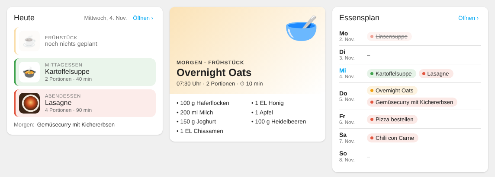

```yaml
type: custom:essensplaner-card
mode: next              # today | next | week
show_ingredients: true  # nur bei "next"
# title: Heute bei uns  # optional, "" blendet die Kopfzeile aus
# days: 7               # nur bei "week"
# start: monday         # "today" (Standard) oder "monday"
```

Ein ganzes Beispiel-Dashboard steht in [`examples/dashboard.yaml`](examples/dashboard.yaml).

## 💶 Preise, Budget & Angebote

Im Panel unter **⚙️ → Budget & Planung** und **⚙️ → Angebote & Preisquellen**:

- **Wochenbudget** in Euro (0 = aus) – Panel, Sensoren und Jarvis zeigen Kosten und Restbudget; „günstig“ planen hält die Woche im Rahmen.
- **Planungsart**: ausgewogen · günstig · Angebote nutzen · Abwechslung · saisonal ([Saison & Fertiggerichte](#-saison--fertiggerichte)).
- **Angebote deiner Läden**: EDEKA (dein Markt) und ALDI SÜD direkt von den Ketten, die übrigen Ketten optional über *marktguru.de* (standardmäßig aus, auf eigenes Risiko) – alles dazu unter [Angebote deiner Läden](#️-angebote-deiner-läden). Abgeglichen wird lokal mit den Zutaten deiner Rezepte, den offenen Artikeln der Einkaufsliste, deinen eigenen Preisen und einer optionalen **Merkliste** (z. B. „Kaffee, Butter“). Hast du [Filialen](#-läden-filialen--preise) gespeichert, zählen deren Postleitzahlen und Ketten (bis zu 4 Postleitzahlen); die Postleitzahl in den Einstellungen darf dann leer bleiben.
- Ohne Online-Quelle: Angebote im Panel oder per Sprache eintragen („Bei Lidl gibt es …“). Ohne „Gültig bis“ bzw. „bis …“ gilt ein Angebot bis zum kommenden Samstag (Ende der Prospektwoche).

**Wie genau sind die Preise?** Die Richtpreise sind typische Discounter-Preise (eingebaute Schätzwerte). Sie werden ersetzt durch deine eigenen Preise (Panel → 🏪 Läden & Preise → Preisliste), die Preise deiner [Kassenzettel](#-kassenzettel), die Onlinepreise von REWE und ALDI SÜD und Normalpreise, die aus Prospekt-Angeboten gelernt werden – mit Hauptladen gelten die Preise dieses Ladens (siehe unten). Preise einer Kette werden **nie als Schätzung für eine andere Kette** genommen. Rezeptkosten rechnen anteilig (was verbraucht wird), die Einkaufsliste mit ganzen Packungen.

## 🏪 Läden, Filialen & Preise

Im Panel gibt es den Tab **„🏪 Läden & Preise“**. Dort legst du deine Filialen an, wählst den **Hauptladen**, verknüpfst die Märkte für die Preisquellen und pflegst die **Preisliste je Laden**. Ohne Filialen verhält sich alles wie in 1.2.

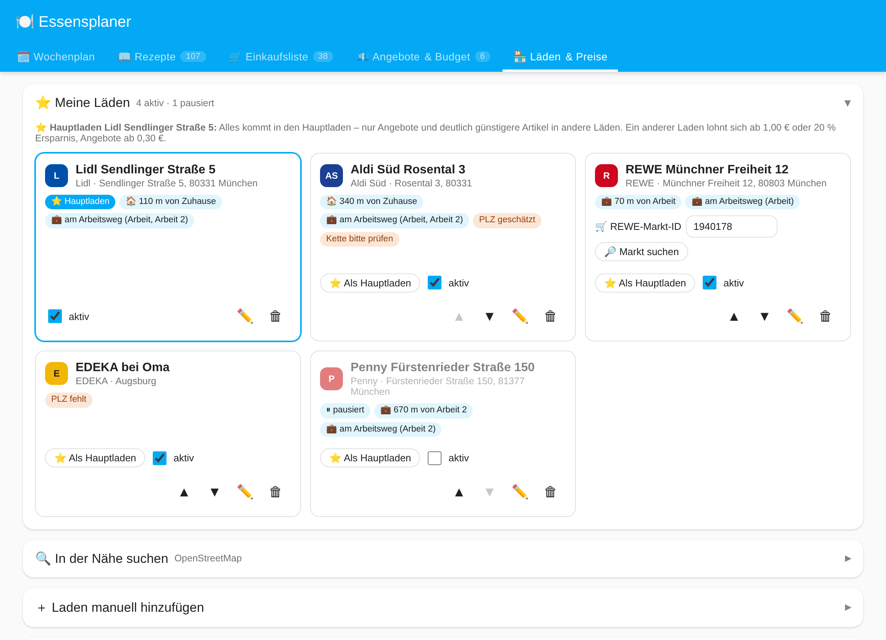

### Hauptladen + Ausnahmen
Die Einkaufsliste kommt **komplett in deinen Hauptladen**. Nur wenn sich ein anderer deiner Läden wirklich lohnt, wandert ein Artikel dorthin:

- ein **Angebot**, das mindestens **0,30 €** spart, oder
- ein **echter Ladenpreis** (eigener, vom Kassenzettel oder gelernter Preis, kein Richtwert), der mindestens **1,00 €** *oder* **20 %** günstiger ist – und immer mindestens 0,20 €.

Hat der Hauptladen für einen Artikel gar keinen Preis (z. B. Kaffee, für den es keinen Richtwert gibt), reicht ein Angebot genau dieses Produkts in einem anderen Laden („Kaffee Crema“, nicht „Eiskaffee“ oder „Milchkaffee“). Bei mehreren Angeboten gewinnt der niedrigste Preis pro kg, Liter bzw. Stück. Optional: **„Extra-Laden lohnt sich ab“** – spart ein zusätzlicher Laden insgesamt weniger, kommt alles zurück in den Hauptladen (Standard 0 = aus); ein Laden, in dem du ohnehin einkaufst (ein Artikel dort von Hand gewählt oder „immer hier“), zählt nicht als Extra-Laden. Alle Schwellen und den Modus stellst du unter **⚙️ → Läden & Einkauf** ein: *Aus – eine Liste wie bisher* · *Alles im Hauptladen* · *Hauptladen + Ausnahmen (empfohlen)*. Die Aufteilung startet, sobald du einen Hauptladen hast; der **erste Supermarkt wird automatisch Hauptladen**.

### Drogerien (Rossmann, dm, Müller, Budni)
Drogerien speicherst du wie Supermärkte (Suche oder von Hand); sie tragen im Panel das Kennzeichen 🧴 Drogerie. Artikel der Abteilungen **🧴 Drogerie & Körperpflege** (Zahnpasta, Duschgel, Shampoo, Deo, Windeln …) und **🧽 Haushalt & Reinigung** (Waschmittel, Spülmittel, Spülmaschinentabs, Toilettenpapier, Küchenrolle, Alufolie …) kommen bei *Hauptladen + Ausnahmen* in deine Drogerie (die erste in deiner Reihenfolge) – sie ist für diese Artikel der „Hauptladen“: Angebote und deutlich günstigere Preise anderer Läden zählen gegen ihren Preis. Lebensmittel wandern nur für ein echtes Angebot genau dieses Produkts in eine Drogerie (z. B. Kaffee bei Rossmann), nie wegen eines Richtwerts oder Normalpreises. Eine Drogerie wird nie automatisch Hauptladen, und Drogerie-Angebote (z. B. „Babyöl“) zählen nie als Angebot für Lebensmittel oder Rezepte. Hast du eine Drogerie in 1.3 notgedrungen als andere Kette gespeichert (z. B. „ROSSMANN Drogeriemarkt“ als Marktkauf), stellt 1.4 sie beim Update automatisch auf die richtige Kette um.

In der Einkaufsliste schaltest du um zwischen **„Nach Laden“** (je Laden Artikel, Zwischensumme und Ersparnis) und **„Nach Abteilung“**. Mit **⇄** an einem Artikel siehst du die Preise aller Läden und wählst den Laden selbst, „Automatisch“ oder **„Immer in diesem Laden kaufen“** (im Laden markiert mit „immer hier“; das gilt für genau diese Filiale, z. B. „Lidl Arbeit“). Deine Wahl bleibt beim Neuerstellen der Liste erhalten. Offene Artikel werden **automatisch neu verteilt**, sobald sich Filialen, Hauptladen, Preise, Angebote oder die Laden-Einstellungen ändern (auch wenn ein Angebot über Nacht endet); **„🔄 Läden neu zuordnen“** macht das von Hand. In der To-do-Liste steht der Laden in der Beschreibung („🏪 Aldi Süd · …“).

| Einkauf nach Laden | Ladenwahl ⇄ | Handy |
|---|---|---|
| 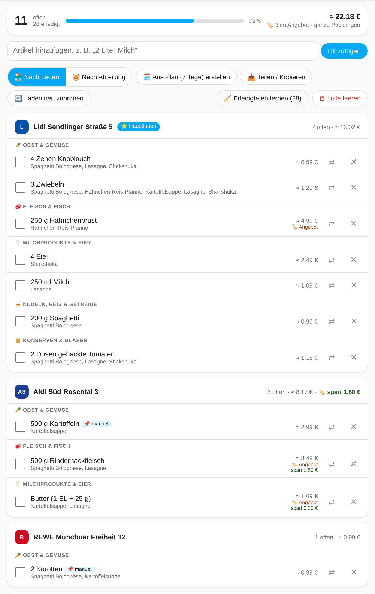 | 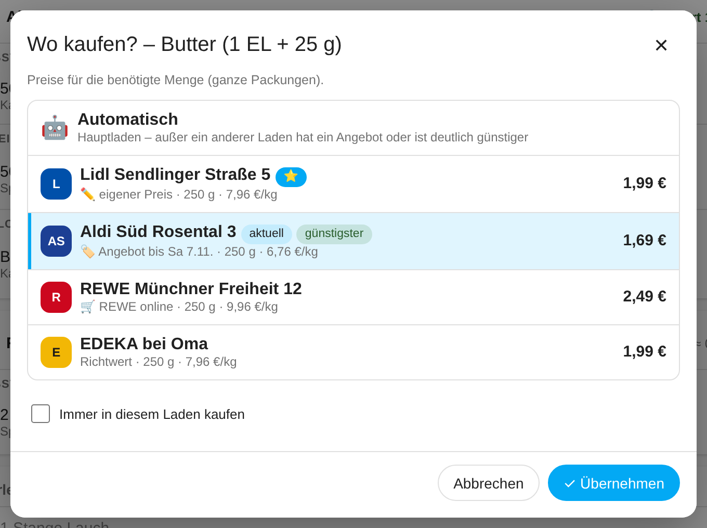 | 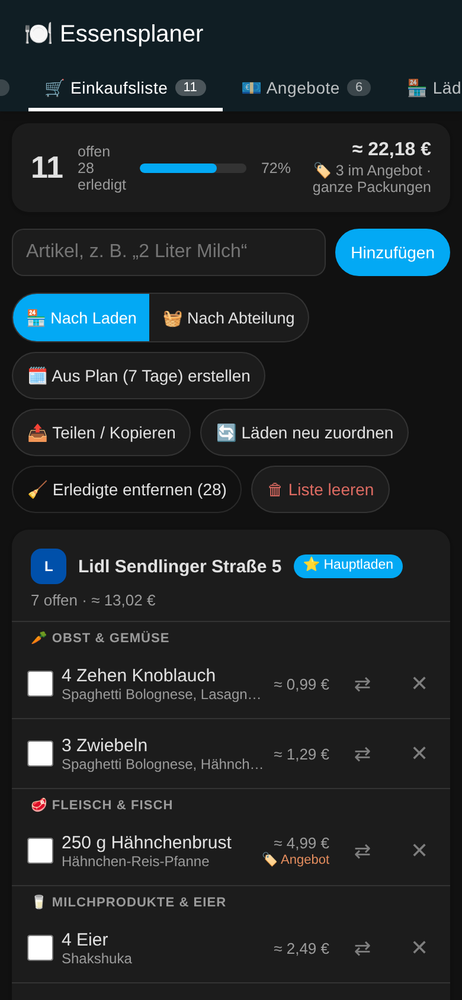 |

### Filialen finden
- **In der Nähe suchen (OpenStreetMap):** sucht Aldi, Lidl, REWE, EDEKA, Penny, Netto, Kaufland, Norma, Globus und Marktkauf sowie die Drogerien Rossmann, dm, Müller und Budni im **Umkreis deiner Zonen** (Standard 3 km). Ohne Auswahl sind das *Zuhause* und alle Zonen mit „Arbeit“ bzw. „Work“ im Namen (z. B. `zone.home`, `zone.arbeit`, `zone.arbeit_2`). Mit **Arbeitsweg** werden auch Läden entlang der Strecke von Zuhause zu diesen Zonen gefunden (Luftlinie, Standard bis 800 m daneben). Treffer zeigen die Entfernung zu Zuhause bzw. zum Arbeitsweg; „＋ Hinzufügen“ übernimmt sie in deine Läden. Ergebnisse werden 30 Tage gemerkt, neu gesucht wird höchstens alle 2 Minuten. Der öffentliche OpenStreetMap-Server ist oft ausgelastet – dann fragt der Essensplaner automatisch noch einmal nach (zuletzt bei einem Ersatzserver), eine Suche kann deshalb 1–3 Minuten dauern.
- **Manuell hinzufügen:** Kette, Straße, Postleitzahl und Ort – z. B. wenn ein Laden bei OpenStreetMap fehlt oder bei „Aldi“ unklar ist, ob Süd oder Nord.
- Die **Postleitzahl** einer Filiale ist wichtig: Für sie werden die Angebote gesucht. Mit Online-Angeboten wird eine neue Postleitzahl (oder Kette) etwa eine Minute nach dem Speichern abgefragt, danach täglich.
- **Märkte verknüpfen** (für die Preisquellen): an einer REWE-Filiale „🔎 Markt suchen“ (Markt-ID für die REWE-Onlinepreise), an einer EDEKA-Filiale „🔎 EDEKA-Markt suchen“ (für die Angebote genau deines Markts), an einer ALDI-SÜD-Filiale „🔗 ALDI-Filiale verknüpfen“ (wird sonst automatisch über die Lage bestimmt).
- Zonen, Umkreis und Arbeitsweg stellst du unter **⚙️ → Läden & Einkauf** ein.

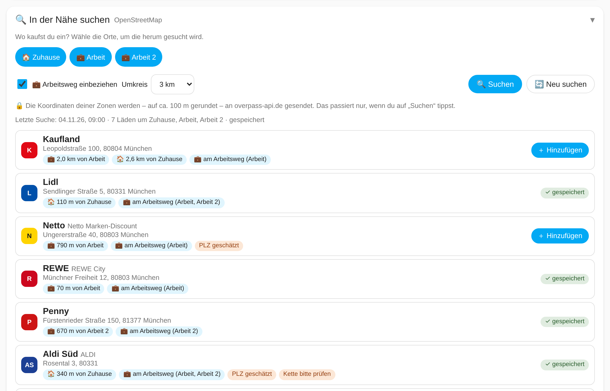

### Preisliste je Laden
Die Preisliste zeigt je Zutat den Richtwert und die Preise deiner Läden nebeneinander, der günstigste ist markiert; jede Zelle lässt sich bearbeiten (auf dem Handy ein Laden + „Günstigster“, der Richtwert steht unter dem Artikel). Unter einem Preis steht das aktuelle Angebot dieses Ladens („🏷️ 1,19 € bis Sa“, nur zur Anzeige; ohne Normalpreis „kein Normalpreis bekannt“). Drogerie-Spalten sind gekennzeichnet, und ein Filter zeigt alle Zeilen, nur Lebensmittel oder nur Drogerie & Haushalt. Welcher Preis gilt, wird je Laden in dieser Reihenfolge entschieden:

1. dein **eigener Ladenpreis** (z. B. „Butter bei Aldi Süd 1,79 €“ – getippt oder von einem [Kassenzettel](#-kassenzettel); der neuere gewinnt)
2. **gelernter Ladenpreis** (höchstens 180 Tage alt; REWE- bzw. ALDI-SÜD-Onlinepreis vor Prospekt-Normalpreis)
3. dein **eigener allgemeiner Preis**
4. **gelernter allgemeiner Preis**
5. **Richtwert**

Gültige Angebote des Ladens werden zusätzlich verglichen (in ganzen Packungen; ein Angebot ohne Packungsgröße gilt für die übliche Packung des Ladens). Ohne ladenspezifische Preise kostet ein Artikel überall gleich viel und wird deshalb nie verschoben. Hast du zwei Filialen derselben Kette (z. B. REWE zu Hause und bei der Arbeit), zählt ein Angebot, das nur für die zweite gefunden wurde, für diese Filiale.

Mit Hauptladen (Filialen) gilt ein Preis in einer Ladenzelle nur für diesen Laden – dein allgemeiner Preis (Spalte Richtwert) bleibt dabei unverändert. Ohne Filialen (Spalten aus den Läden der Einstellungen) wird er wie in 1.2 zusätzlich dein allgemeiner Preis, mit dem Laden als Hinweis; ein allgemeiner Preis ohne Laden bleibt aber stehen.

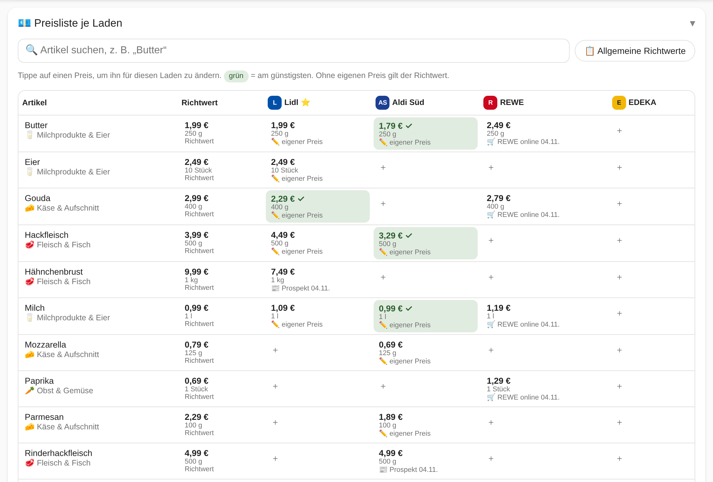

### Welche Preise gibt es für welche Kette?
Ehrlich gesagt: **Normalpreise** veröffentlichen nur wenige Ketten so, dass der Essensplaner sie abfragen kann. Für alle anderen gibt es echte Preise nur von dir – getippt oder vom [Kassenzettel](#-kassenzettel) – und die Normalpreise, die in Prospekten stehen (Streichpreise, Lidls „Normalpreis“). Geschätzt wird nichts aus anderen Ketten.

| Kette | Normalpreise | Angebote |
|---|---|---|
| **REWE** | REWE-Onlinepreise (experimentell, aus) für deinen Markt | mit derselben Einstellung: gerade reduzierte Artikel (Streichpreis) der gesuchten Zutaten; eine öffentliche Liste aller Angebote gibt es nicht – den Prospekt über marktguru (optional) oder selbst eingetragen |
| **ALDI SÜD** | ALDI-SÜD-Preise (experimentell, aus) | mit derselben Einstellung: die Wochenangebote und gerade reduzierte Artikel (Streichpreis) |
| **EDEKA** | Kassenzettel, eigene Preise (die EDEKA-Angebote nennen keinen Normalpreis) | **EDEKA-Angebote** deines Markts direkt von edeka.de (aus); ohne Markt-Verknüpfung über marktguru oft nur die Prospektseiten als Bilder |
| **Lidl, Penny, Netto, Kaufland, ALDI Nord, Globus, Marktkauf** | Kassenzettel, eigene Preise; mit marktguru die Normalpreise aus dem Prospekt (Streichpreise, Lidls „Normalpreis“) | über marktguru (optional, eigenes Risiko) oder selbst eingetragen |
| **NORMA** | Kassenzettel, eigene Preise | über marktguru meist nur die Prospektseiten als Bilder – das Angebot trägst du mit „Angebot aus Prospekt eintragen“ selbst ein |
| **Rossmann, dm, Müller, Budni** | Kassenzettel, eigene Preise; mit marktguru Streichpreise aus dem Prospekt | über marktguru (optional) oder selbst eingetragen; App-Preise und Coupons werden als Hinweis gezeigt |

Dazu kommen immer die eingebauten **Richtwerte** (typische Preise je Zutat, nicht je Kette) – sie gelten nur, solange es für einen Laden nichts Besseres gibt, und verschieben nie einen Artikel in einen anderen Laden.

### Gelernte Normalpreise aus Prospekten
Viele Angebote nennen den Normalpreis – als Streichpreis („statt 2,49 €“), bei Lidl als „Normalpreis: 1.35“, bei ALDI SÜD als alter Preis. Daraus lernt der Essensplaner nach jedem Abruf für **alle Artikel der Preisliste** den Preis **je Laden**, mit **Verlauf** (bis zu 12 Einträge) und einer Plausibilitätsprüfung gegen den Richtwert. Angebote „nur online“ zählen nicht. Quelle sind die Prospekte deiner Läden (marktguru nur, wenn eingeschaltet; ALDI SÜD mit seiner Einstellung – die EDEKA-Angebote nennen keinen Normalpreis).

### REWE-Onlinepreise (experimentell)
Standardmäßig **aus**. Eingeschaltet (**⚙️ → Angebote & Preisquellen**) holt der Essensplaner einmal pro Woche Normalpreise aus dem REWE-Onlineshop für deine REWE-Filiale. Der Knopf „Preise aktualisieren“ fragt nach einem erfolgreichen Abruf frühestens 6 Stunden später erneut. Dafür braucht die Filiale eine **Markt-ID** (Knopf „Markt suchen“ an der REWE-Filiale bzw. Aktion `essensplaner.find_rewe_markets`).

> ⚠️ Das ist eine **inoffizielle Schnittstelle** des REWE-Onlineshops: Markt-ID und Suchbegriffe (Zutaten, Artikel der Einkaufsliste, deine Artikelsuche) gehen an `www.rewe.de`. Lehnt REWE automatische Abfragen ab, wird **7 Tage pausiert**; gelernte Preise bleiben. Es kann jederzeit aufhören zu funktionieren – Schutzmechanismen werden bewusst nicht umgangen.

Ist ein gesuchter Artikel gerade **reduziert** (Streichpreis), wird der Streichpreis als Normalpreis gelernt und der reduzierte Preis ist bis Samstag ein **Angebot** deiner REWE-Filiale (🏷️, auch unter „Alle Angebote meiner Läden“). Eine öffentliche Liste **aller Angebote eines REWE-Markts** gibt es nicht (die Angebotsseiten von rewe.de beantworten automatische Abfragen mit einer Bot-Prüfung) – die übrigen REWE-Angebote kommen deshalb weiter über marktguru (optional) oder von dir.

### ALDI-SÜD-Onlinepreise (experimentell)
Standardmäßig **aus**. Eingeschaltet (**⚙️ → Angebote & Preisquellen → ALDI-SÜD-Preise**) holt der Essensplaner einmal pro Woche Normalpreise von der ALDI-SÜD-Website für deine **ALDI-SÜD-Filiale** – wie bei REWE für die geplanten und häufigen Zutaten und die offenen Artikel der Einkaufsliste. Ist ein Artikel gerade **reduziert** (Streichpreis), wird der Streichpreis als Normalpreis gelernt und der reduzierte Preis erscheint bis Samstag als **Angebot** (🏷️). Die ALDI-Filiale wird beim ersten Abruf (bzw. kurz nachdem du eine ALDI-SÜD-Filiale hinzufügst) automatisch über die Lage deiner Filiale bestimmt (sonst über die Zone „Zuhause“) – oder du wählst sie mit „🔗 ALDI-Filiale verknüpfen“ bzw. der Aktion `essensplaner.find_aldi_stores` (ALDI SÜD sucht nur nach Koordinaten). Die Preise sind regional gleich, eine Filiale genügt. Mit eingeschalteter Einstellung sucht auch „Artikel hinzufügen“ bei einem ALDI-SÜD-Laden live.

> ⚠️ Auch das ist eine **inoffizielle Schnittstelle** (`api.aldi-sued.de`): Suchbegriffe und die Filialnummer gehen an ALDI SÜD, für die Filialsuche einmal die Koordinaten deiner ALDI-Filiale (auf ca. 100 m gerundet) bzw. von Zuhause (auf ca. 1 km gerundet). Die Produktbilder der Wochenangebote lädt dein Browser von `dm.emea.cms.aldi.cx`. Lehnt ALDI SÜD ab (oder antwortet unerwartet), wird **7 Tage pausiert**; gelernte Preise bleiben. Mit der Einstellung kommen auch die **Wochenangebote** von ALDI SÜD in die Angebote deiner Läden (1–2 Anfragen je Angebotsabruf); marktguru wird für ALDI SÜD dann nicht gefragt.

### EDEKA-Angebote deines Markts
Standardmäßig **aus**. Jeder EDEKA-Kaufmann hat eigene Angebote – eingeschaltet (**⚙️ → Angebote & Preisquellen → EDEKA-Angebote**) lädt der Essensplaner einmal am Tag (06:xx, sobald die Angebote einen Tag alt sind oder die Prospektwoche vorbei ist) die **Prospekt-Angebote deines EDEKA-Markts von www.edeka.de**: Preis, Packung, Grundpreis, gültig bis, PAYBACK-/App-Hinweise, Pfand als Hinweis (nie im Preis). Angebote, die zu deinen Rezepten, der Merkliste oder der Einkaufsliste passen, fließen wie andere Angebote in Planung, Budget und Einkaufsliste ein – nur für diese EDEKA-Filiale; alle Angebote siehst du unter [Angebote deiner Läden](#️-angebote-deiner-läden). Dafür braucht die Filiale eine **EDEKA-Markt-ID** („🔎 EDEKA-Markt suchen“ an der Filiale bzw. Aktion `essensplaner.find_edeka_markets`, dann mit `essensplaner.save_branch` als `edeka_market_id` speichern); etwa eine Minute nach dem Verknüpfen werden die Angebote geladen. Lehnt EDEKA ab, wird 7 Tage pausiert; die Angebote bleiben bis zu ihrem Ende. Die Angebotsbilder lädt dein Browser von `offer-images.api.edeka`.

> ⚠️ **Hinweis (Stand 11/2026):** Die Nutzungsbedingungen von edeka.de untersagen inzwischen das automatische Auslesen der Website ohne Zustimmung von EDEKA (Abschnitt „Automatisierte Zugriffe und Webscraping“). Die EDEKA-Angebote nutzen dieselbe Schnittstelle wie die Website im Browser – wenn du sie einschaltest, dann wie marktguru nur auf eigenes Risiko und nur für dich privat. Den EDEKA-Prospekt liest der Essensplaner deshalb nicht selbst, er verlinkt ihn nur (siehe [Prospekte aller Filialen](#-prospekte-aller-filialen)).

### Artikelsuche beim Hinzufügen
Tippst du im Feld **„Artikel hinzufügen“**, erscheinen passende Artikel **aus allen deinen Läden** (seit 1.5) – mit Bild vorne, Laden, Preis, Packung, Grundpreis und 🏷️ Angebot, der Artikel selbst vor anderen Produkten („Butter“ vor „Butterkeksen“) und darin das **Günstigste zuerst**: aus der [Artikel-Datenbank](#-artikel-datenbank), der Preisliste, gültigen Angeboten, deinen zuletzt gekauften Artikeln und zuletzt den Richtwerten. Mit Online-Angeboten bzw. den REWE- und ALDI-SÜD-Onlinepreisen (bei einem REWE- bzw. ALDI-SÜD-Laden) wird zusätzlich live gesucht. Antippen fügt den Artikel **mit Preis und Laden** hinzu – ein Produkt der Artikel-Datenbank als genau dieses Produkt; Enter ohne Auswahl übernimmt den Text wie bisher.

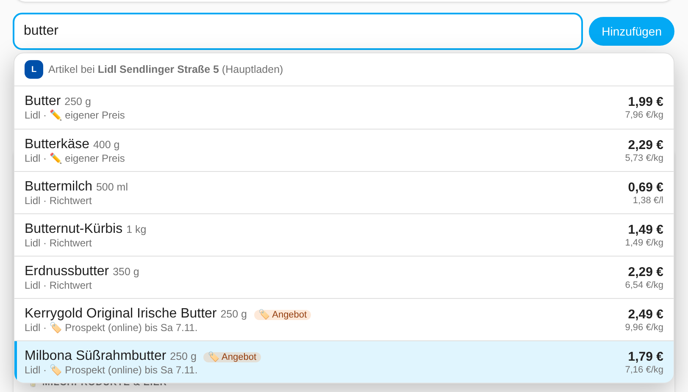

## 🏷️ Angebote deiner Läden

Der Essensplaner hält **alle aktuellen und kommenden Angebote deiner gespeicherten Läden** bereit (Angebotskatalog), getrennt nach Laden – nicht nur die, die zu deinen Rezepten passen. Jede Quelle schaltest du selbst ein (**⚙️ → Angebote & Preisquellen**); für neue Installationen sind alle aus.

| Kette | Quelle | Was |
|---|---|---|
| EDEKA | direkt von edeka.de (Einstellung „EDEKA-Angebote“) | alle Angebote deines verknüpften Markts, täglich |
| ALDI SÜD | direkt von aldi-sued.de (Einstellung „ALDI-SÜD-Preise“) | die Wochenangebote und reduzierte Artikel |
| Lidl, REWE, Penny, Netto, Kaufland, ALDI Nord, Rossmann, dm … | marktguru (nur eingeschaltet, eigenes Risiko) | der ganze Prospekt der Kette an der Postleitzahl deiner Filiale |
| NORMA, EDEKA ohne Markt-Verknüpfung | marktguru | oft nur die Prospektseiten als Bilder (mit Link zum Prospekt) |

| Alle Angebote meiner Läden | Handy |
|---|---|
| 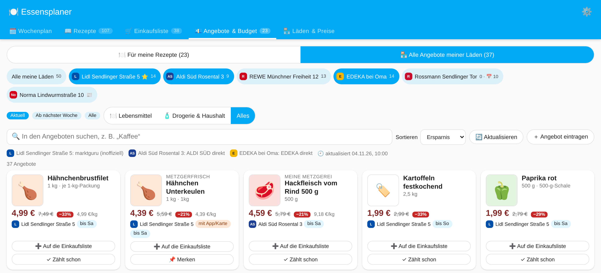 | 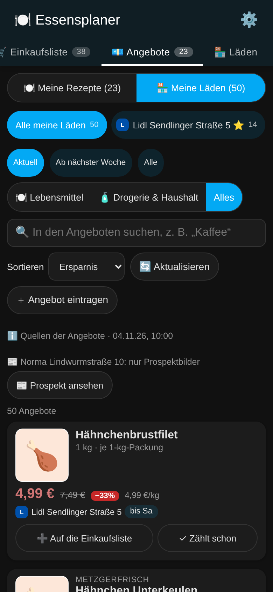 |

Im Panel zeigt der Tab **💶 Angebote** zwei Ansichten: **„🍽️ Für meine Rezepte“** (die passenden Angebote wie bisher, mit Budget) und **„🏪 Alle Angebote meiner Läden“**: oben deine Läden als Chips (mehrere wählbar, die Auswahl wird gemerkt), dazu Aktuell / Ab nächster Woche / Alle, Lebensmittel / Drogerie & Haushalt / Alles, eine Suche und die Sortierung nach Ersparnis, Preis, Grundpreis, Name oder Laden. Jede Karte zeigt Bild, Marke, Packung, Preis mit Streich- bzw. Normalpreis, App-Preis, PAYBACK, „nur online“, Pfand, Grundpreis und Gültigkeit („ab Mo 09.11.“, „bis Sa“); **„➕ Auf die Einkaufsliste“** setzt den Artikel mit Angebotspreis in diesen Laden, **„📌 Merken“** übernimmt das Angebot als eigenes. Es gibt 60 Angebote je Seite („Mehr laden“). Läden, für die es nur Prospektbilder gibt (z. B. NORMA), erscheinen als Kachel mit vier Prospektseiten, „Prospekt öffnen ↗“ und „Angebot aus Prospekt eintragen“ – auch nachdem du dort schon Angebote eingetragen hast. Unter den Chips steht je Laden die Quelle (EDEKA direkt, ALDI SÜD direkt, marktguru inoffiziell) – ist für einen Laden keine eingeschaltet, sagt die Seite, welche.

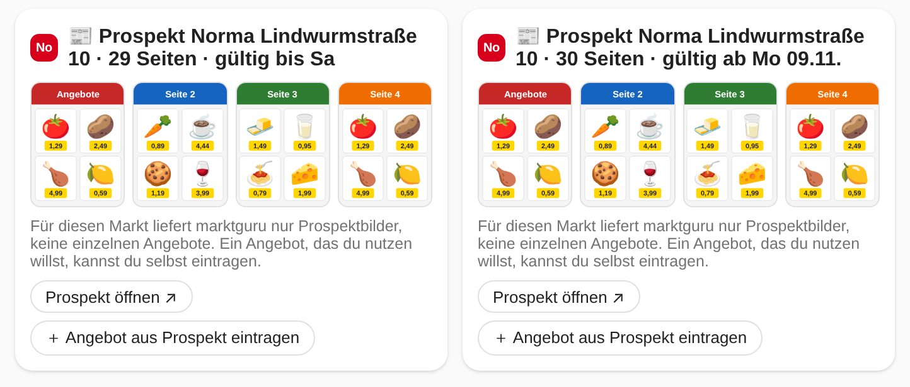

Angebote, die zu deinen Rezepten, der Merkliste, der Einkaufsliste oder deinen eigenen Preisen passen, zählen für Planung, Budget und die Laden-Aufteilung der Einkaufsliste. Setzt du nach dem Abruf etwas Neues auf die Einkaufsliste, planst ein Rezept oder trägst einen Preis ein, gleicht der Essensplaner die gespeicherten Angebote etwa eine halbe Minute später lokal neu ab – ohne neue Anfrage (auch beim täglichen Check und mit „Angebote aktualisieren“, solange ein neuer Abruf noch gesperrt ist). Ein Produkt mit Sorten nach dem Komma („Buitoni Pizza, Salami oder Schinken“) ist ein Angebot des Produkts selbst (Pizza), nicht der Sorten. In der Preisliste steht in jeder Zelle zusätzlich das aktuelle Angebot dieses Ladens (nur zur Anzeige). App-Preise („mit Lidl Plus App 1,59 €“, Rossmann-Coupons), REWE-Bonus und „nur online“ werden als Hinweis erkannt; jedes Angebot hat eine Art (Lebensmittel, Getränk, Drogerie, Haushalt, Non-Food), damit Jacken und Akkuschrauber nicht zwischen den Lebensmitteln stehen.

**Wann wird abgefragt?** EDEKA einmal am Tag (06:xx), ALDI SÜD und marktguru alle 3 Tage und zum neuen Prospekt (Samstag, Sonntag und Montag je einmal – REWE und Netto veröffentlichen die neue Woche erst am Sonntag), ebenfalls morgens um 06:xx – und wenn du Läden hinzufügst oder eine EDEKA- bzw. ALDI-Filiale verknüpfst. Schlägt ein Abruf fehl, versucht es der Essensplaner beim nächsten Tagesabruf wieder. marktguru lädt je Kette und Postleitzahl den ganzen Prospekt (für sechs Läden etwa 10 Anfragen, höchstens 30 je Abruf, 1,5 s Abstand); Ketten mit direkter Quelle (EDEKA, ALDI SÜD) werden dort nicht gefragt. „Angebote aktualisieren“ fragt höchstens einmal pro Stunde (außer deine Läden haben sich geändert). Alle Abfragen senden die ehrliche Kennung `HA-Essensplaner/1.5`.

> ⚠️ **Hinweis zu marktguru.de – nur auf eigenes Risiko und nur als Ergänzung:** Es gibt keine offizielle Schnittstelle. Die Integration nutzt die inoffizielle Web-Schnittstelle von marktguru.de, die sich jederzeit ändern kann. Die **AGB von marktguru** (info.marktguru.de/agb, Stand Februar 2026) untersagen ausdrücklich „den Einsatz von Computerprogrammen zum automatischen Auslesen von Daten“ und erlauben nur die private Nutzung ohne Weitergabe. Wenn du marktguru einschaltest, tust du das auf eigenes Risiko und nur für dich privat; der Essensplaner hält die Abfragen klein (ehrliche Kennung, 1,5 s Abstand, wenige Prospekte pro Woche, nur deine Läden) und pausiert 7 Tage, wenn marktguru ablehnt – auch für die Live-Suche und „Artikel hinzufügen“. Schaltest du marktguru aus, verschwinden seine Angebote sofort aus der Angebotsliste, der Preisliste und der Planung. marktguru ergänzt nur die direkten Quellen der Ketten (EDEKA, ALDI SÜD, REWE-Onlinepreise) für Läden, die keine eigene haben. Home Assistant braucht dafür Internetzugriff auf `www.marktguru.de` und `api.marktguru.de`; Bilder lädt dein Browser von `cdn.marktguru.de`. Ist die Quelle nicht erreichbar, bleiben die zuletzt geladenen Angebote erhalten und der Fehler wird angezeigt.

Gespeichert wird der Katalog in einer eigenen Datei (`/config/.storage/essensplaner.catalog.<entry_id>`); für das Panel gibt es den Websocket `essensplaner/store_offers` (Filter nach Laden, aktuell/kommend, Art, Suche, „nur meine Zutaten“, Sortierung, Seiten).

### 📰 Prospekte aller Filialen

Neben den Einzelangeboten hält der Essensplaner die **Prospekte deiner gespeicherten Filialen** bereit – aktuelle und kommende Woche, je Filiale:

| Quelle | Einschalten (Standard) | Was |
|---|---|---|
| marktguru | ⚙️ → marktguru-Angebote (aus, eigenes Risiko) **und** ⚙️ → Angebote & Preisquellen → „Prospekte aller Filialen“ (an) | die Prospektseiten als Bilder für **jede** Filiale (auch EDEKA und ALDI SÜD) – je Postleitzahl und Branche (Supermärkte, Discounter, Drogerien) eine Anfrage; ausgeschaltet wie in 1.4 nur für Ketten ohne Einzelangebote (NORMA) |
| ALDI SÜD | ⚙️ → ALDI-SÜD-Preise (aus) | ohne die marktguru-Prospekte: Titelbild und Link der Prospekte dieser, der nächsten und der übernächsten Woche von der Prospektseite www.aldi-sued.de/prospekte (eine Anfrage) |
| jede Kette | – | ein Link zur Prospektseite der Kette (ALDI SÜD, ALDI Nord, Lidl, REWE, EDEKA, Penny, Netto, Kaufland, NORMA, Rossmann, Müller, Budni) – **ohne Abfrage**, dein Browser öffnet sie |

**Wann wird abgefragt?** Mit den Angeboten (nach den Einzelangeboten, höchstens **12 Prospekt-Anfragen** je Abruf innerhalb der 30, der Rest beim nächsten Mal) und beim täglichen Check um 06:xx – aber eine Prospektliste nur, wenn sie fällig ist: nach 3 Tagen, sonntags und montags einmal, wenn eine Kette noch keinen Prospekt für die neue Woche hat, nach 24 Stunden, wenn eine Kette gar keinen aktuellen Prospekt hat, und wenn du Läden hinzufügst. „Angebote aktualisieren“ folgt denselben Regeln (Prospekte ändern sich innerhalb der Woche kaum). Derselbe Prospekt an mehreren Postleitzahlen erscheint einmal, mit allen Filialen, für die er gilt. Die Seitenbilder lädt dein Browser von `cdn.marktguru.de` (klein für die Übersicht, mittel zum Blättern, groß zum Zoomen); bei ALDI SÜD das Titelbild von `dm.emea.cms.aldi.cx`, die Seiten selbst öffnet „Öffnen ↗“ auf prospekt.aldi-sued.de.

**Warum nicht direkt von jeder Kette?** Geprüft (11/2026, ehrliche Kennung, robots.txt und Nutzungsbedingungen): EDEKA zeigt den Prospekt deines Markts als Blätterkatalog, die **Nutzungsbedingungen von edeka.de untersagen aber seit 2026 ausdrücklich das automatische Auslesen** der Website ohne Zustimmung – deshalb nur der Link. Lidl hat eine öffentliche Prospekt-Schnittstelle, aber im Essensplaner keine eigene Einstellung dafür – deshalb nur der Link. REWE und Netto lehnen Abfragen mit der ehrlichen Kennung ab, Rossmann schließt KI-Agenten in seiner robots.txt aus, Globus, Marktkauf und dm haben keine Prospektseite der ganzen Kette. Nur ALDI SÜD (öffentlich verlinkt, robots.txt erlaubt, keine Schlüssel, Nutzungsbedingungen nur für das Kundenkonto) wird direkt gelesen – und nur mit seiner Einstellung.

**Im Panel** (Tab „💶 Angebote“ → **„📰 Prospekte“**): je Prospekt eine Kachel mit Titelbild, Kette, Filialen und Gültigkeit – „Diese Woche“, „Nächste Woche“ oder „Alle“. Antippen öffnet den Prospekt **im Vollbild zum Blättern** (wischen, ‹ › oder Pfeiltasten, Schieberegler für die Seite; nur die Seiten in der Nähe werden geladen); Doppeltippen oder 🔍 vergrößert die Seite, „Öffnen ↗“ zeigt den Prospekt auf marktguru bzw. bei der Kette. Ohne marktguru gibt es je Kette eine Kachel mit dem Link zu ihrer Prospektseite.

Für eigene Oberflächen gibt es den Websocket `essensplaner/leaflets` (`when`: `current` / `upcoming` / `all`, optional `branch_ids`): je Prospekt Kette, Titel, gültig von/bis, Seitenzahl, Titelbild, die ersten Seiten, Bildvorlagen für Seiten, Zoom und Vorschau (`page_url_template` mit `{page}`, ab Seite 0), Link und die Filialen; dazu je Filiale die Anzahl aktueller und kommender Prospekte und die Links der Ketten. Die Aktion `essensplaner.get_leaflets` liefert dasselbe für Automationen:

```yaml
action: essensplaner.get_leaflets
data:
  store: "Lidl"     # optional: Kette oder Filiale
  when: current
response_variable: prospekte
```

## 📦 Artikel-Datenbank

Der Essensplaner merkt sich **jedes Produkt mit echtem Preis**, das er ohnehin sieht – je Kette, mit Bild (nur als Link), Marke, Packung, Normalpreis, Angebot, Grundpreis und Preisverlauf: die Angebote deiner Läden (EDEKA, ALDI-SÜD-Wochenangebote, marktguru), die passenden Treffer der REWE- und ALDI-SÜD-Onlinepreise und der Artikelsuche, die Zeilen deiner Kassenzettel und eigene Artikel. **Dafür gibt es keine zusätzliche Abfrage**, und es kommen nur echte Preise hinein (Onlineshop, Prospekt, Kassenzettel, eigene Eingabe) – nie geschätzte Preise oder Preise einer anderen Kette. Beim ersten Start nach dem Update wird sie einmal aus dem Gespeicherten gefüllt (aktuelle Angebote, REWE-/ALDI-Onlinepreise, Kassenzettel der letzten 90 Tage, Angebote auf der Einkaufsliste).

- **Ein Produkt je Kette:** REWE- und ALDI-SÜD-Artikel erkennt der Essensplaner an ihrer Artikelnummer, alle anderen an Marke + Name + Packung („Kerrygold Irische Butter 250 g“) – auch wenn das Angebot nächste Woche eine neue Nummer hat. Derselbe Markenartikel bei einer anderen Kette erscheint als „auch bei …“ (nie für Eigenmarken wie ja!, Milsani, Milbona, K-Classic oder GUT&GÜNSTIG).
- **Kassenzettel:** eine Zeile gehört zu einem bekannten Produkt der Kette, wenn Zutat und Preis (±15 %) passen; sonst entsteht ein Kassenzettel-Produkt. Jede Zeile zählt als „gekauft“.
- **⭐ Lieblingsprodukt und gemerkte Käufe:** je Zutat kannst du ein Lieblingsprodukt festlegen; was du aus einem Angebot auf die Einkaufsliste setzt oder abhakst, merkt sich der Essensplaner (höchstens drei Produkte je Zutat).
- **Klein und schnell:** höchstens 3000 Produkte, Verlauf mit höchstens 8 Preisen, Bilder nur als Links, gespeichert in einer eigenen Datei (`/config/.storage/essensplaner.products.<entry_id>`, etwa 1–2 MB). Täglich wird aufgeräumt: Produkte, die 120 Tage nicht mehr vorkamen, gehen; eigene Artikel, Lieblingsprodukte, gemerkte Käufe und Produkte auf der Einkaufsliste, in Rezepten oder Anlässen bleiben, Produkte mit gültigem Angebot ebenso. Non-Food (Kleidung, Technik) wird nicht gespeichert. Ein Normalpreis gilt 90 Tage.
- **Eigene Artikel:** mit Laden, Name, Marke, Packung, Preis und Bild-Link (`https://…`); sie werden nie aufgeräumt. Ein Fertiggericht (TK-Pizza …) lässt sich als Rezept speichern („Nach Packungsanleitung zubereiten.“, mit Bild).

**Im Panel** (Tab **„📦 Artikel“**, zwischen Einkaufsliste und Angeboten): Karten wie bei den Angeboten (Bild, Marke, Name, Packung, Preis, durchgestrichener Normalpreis, Grundpreis, Laden, woher der Preis stammt), Auswahl nach Laden, Abteilung, ⭐ Favoriten, 🏷️ Angeboten, 🧾 gekauft und ✍️ eigenen, Suche und Sortierung (Preis, Grundpreis, Ersparnis, Name, zuletzt gesehen). ☆/⭐ auf einer Karte macht den Artikel zum Lieblingsprodukt seiner Zutat, „➕ Auf die Einkaufsliste“ setzt genau dieses Produkt auf die Liste. Antippen zeigt die Details: Preisverlauf, „Auch bei …“ (derselbe Markenartikel bei deinen anderen Läden), die Zutat(en) mit ⭐, „🍕 Als Rezept speichern“ und – bei eigenen Artikeln – Bearbeiten und Löschen. „＋ Eigener Artikel“ trägt einen Artikel mit Laden, Name, Marke, Packung, Preis, Zutat, Abteilung und Bild-Link ein. Auf der **Einkaufsliste** steht vor jedem Artikel sein Bild (sonst das Symbol der Abteilung), darunter Marke und Produkt; Antippen öffnet **„Produkt wählen“** mit den passenden Artikeln aller Läden, günstigste für die benötigte Menge zuerst, und „⭐ Immer dieses“.

Aktionen: `search_products` (Suche nach Marke, Name oder Zutat, optional Laden, nur Favoriten / Angebote / gekauft / eigene, Sortierung) und `save_product` (eigenen Artikel anlegen oder ändern). Für das Panel (Tab „📦 Artikel“) und eigene Oberflächen gibt es die Websockets `essensplaner/products` (Seiten mit Filtern für Laden, Kategorie, Art, Favoriten, Angebote, gekauft, eigene und Sortierung nach Preis, Grundpreis, Ersparnis, Name, zuletzt gesehen), `essensplaner/product_detail` (Preisverlauf, „auch bei …“, Zutaten), `essensplaner/product_save`, `essensplaner/product_delete`, `essensplaner/product_favorite`, `essensplaner/product_alternatives` (Produkte einer Zutat in allen Läden, günstigste für die benötigte Menge zuerst) und `essensplaner/product_to_recipe`.

```yaml
action: essensplaner.search_products
data:
  query: Butter
  only: offers
response_variable: artikel   # artikel.products: Marke, Name, Packung, Preis, Laden, Bild
```

### 🛒 Einkaufsliste aus der Artikel-Datenbank

Beim Erstellen der Einkaufsliste (und immer, wenn Preise, Angebote oder Läden sich ändern) bekommt jeder Artikel das **Produkt**, das du in seinem Laden kaufst – mit Bild, Marke und Packung (`product`, Grund in `product_reason`), in der Beschreibung als „📦 Bergland Butter“:

1. das Produkt der Rezept-Zutat (`product_id` einer Zutat) oder das, das du mit „Produkt wechseln“ gewählt hast,
2. dein **⭐ Lieblingsprodukt** der Zutat,
3. ein Produkt, das du dort schon öfter gewählt oder gekauft hast (zweimal oder in den letzten 60 Tagen),
4. sonst das **günstigste passende Produkt** dieser Kette für die benötigte Menge – bevorzugt das Angebot, mit dem der Artikel ohnehin berechnet ist.

Ein ⭐ Lieblingsprodukt, ein gewähltes oder gemerktes Produkt bestimmt auch den Preis des Artikels. Ein **⭐ Lieblingsprodukt bindet den Laden** wie „immer hier“: der Artikel kommt in die Kette des Lieblingsprodukts (den Hauptladen, wenn es dort – als Markenartikel auch bei einer anderen Kette – zu haben ist), solange diese Kette einer deiner Läden ist; „immer hier“ und eine eigene Ladenwahl gehen vor. Gemerkte Käufe binden keinen Laden – sie zählen nur, wenn der Artikel ohnehin in dieser Kette landet (nicht, wenn er wegen eines günstigeren Angebots dorthin gewechselt ist). Ein Produkt, das du selbst gewählt hast, zählt auch beim Vergleich der Läden: dort kostet der Artikel den Preis dieses Produkts (bzw. desselben Markenartikels), Angebote anderer Produkte zählen dann nicht. Auch die anderen Läden eines Artikels (`alternatives`) nennen ihr Produkt, und „Wo ist Butter am günstigsten?“ (`compare_prices`) sagt, welches Produkt hinter dem günstigsten Preis steckt.

**Produkt wechseln:** die Aktion `set_shopping_product` (bzw. der Websocket `essensplaner/shopping_set_product`) kauft einen Artikel der Liste als ein anderes Produkt – mit dessen Angebots- oder Normalpreis in dessen Laden (bei aufgeteilter Liste wechselt der Artikel dorthin); `remember: pick` merkt die Wahl, `remember: favorite` macht das Produkt zum ⭐ Lieblingsprodukt der Zutat. Die Auswahl dafür liefert `essensplaner/product_alternatives`. Ohne `product_id` wählt die Liste wieder selbst.

**Artikel aus allen Läden:** der Websocket `essensplaner/article_search` sucht mit `scope: all` in **allen deinen Läden** zugleich – Produkte der Artikel-Datenbank, eigene Angebote, eigene und gelernte Ladenpreise, zuletzt gekaufte Artikel und (ohne Laden, zuletzt) die Richtwerte. Der Artikel selbst steht vor anderen Produkten („Butter“ vor „Butterkeksen“), darin das **Günstigste zuerst** (Grundpreis je kg / l, Stückpreise für sich, dann Packungspreis); jeder Treffer hat Bild, Marke, Laden (`store_label`), Normalpreis und `product_id`. Live werden die Online-Quellen aller Ketten gleichzeitig gefragt (je Anbieter höchstens eine Anfrage pro Sekunde). `add_shopping_item` mit `product_id` setzt genau dieses Produkt auf die Liste – mit seinem Preis, in seinem Laden (wie ein gewähltes Angebot) und als gewählt gemerkt. Ohne `scope` (Sprache, Aktionen) wird wie bisher der Hauptladen durchsucht.

```yaml
action: essensplaner.set_shopping_product
data:
  item: Butter
  product_id: "lidl:s1a2b3c4d5"   # aus search_products
  remember: favorite              # ⭐ ab jetzt immer dieses
```

## 🎉 Anlässe & Getränke

Ein **Anlass** ist ein eigener Eintrag im Wochenplan – mit Datum, Uhrzeit, Gästen und Kindern und Gängen (Vorspeise, Hauptgang, Beilagen, Dessert, Snacks, Getränke, Zubehör). Jeder Eintrag ist ein Rezept, ein Produkt der Artikel-Datenbank oder Freitext mit Menge („2,5 kg Grillkohle“).

| Vorlage | Uhrzeit · Dauer | Gänge | Zubehör (je Gäste) |
|---|---|---|---|
| 🎬 Filmabend | 20:00 · 3 h | Hauptgang, Snacks | Popcorn (100 g je 2), Chips, Servietten |
| 🔥 Grillabend | 18:00 · 4 h | 2 × Hauptgang, 2 × Beilage, Dessert | Grillkohle (2,5 kg je 6), Anzünder, Grillsoße, Servietten |
| 👨‍👩‍👧‍👦 Familienessen | 12:30 · 3 h | Hauptgang, Beilage, Dessert | Servietten |
| 🎄 Weihnachtsessen | 18:00 · 4 h | Vorspeise, Hauptgang, 2 × Beilage, Dessert | Servietten, Kerzen |
| 🎆 Silvester | 19:00 · 6 h | Hauptgang, 2 × Snacks | Berliner, Wunderkerzen, Servietten |
| 🎂 Geburtstag | 15:00 · 4 h | Hauptgang, Kuchen, Snacks | Kerzen, Servietten, Pappteller |
| 🥐 Brunch | 10:30 · 3 h | 2 × Hauptgang, Snacks | Brötchen (2 je Person), Servietten |
| 🧀 Raclette-Abend | 19:00 · 4 h | Beilage, Dessert | Raclettekäse (200 g je Person), Kartoffeln, Schinken, Champignons, Gurken, Silberzwiebeln |
| 🫕 Fondue | 19:00 · 4 h | 2 × Beilage, Dessert | Fondue-Fleisch (200 g je Person), Baguette, Brennpaste |
| 🎉 Party | 19:00 · 5 h | Hauptgang, 3 × Snacks | Chips, Salzstangen, Servietten, Eiswürfel |
| 🐣 Osteressen | 12:30 · 4 h | Vorspeise, Hauptgang, Beilage, Dessert | Eier zum Färben, Servietten |

- **Vorschläge je Gang** nach denselben Regeln wie der Wochenplan (Favoriten, Bewertung, lange nicht gekocht, Angebote) und passend zur Vorlage (zum Grillabend Gegrilltes, zum Filmabend Pizza und Fingerfood); Kinder zählen als halbe Portion. Ein Rezept kommt in den Gang, den seine Kategorien sagen (Vorspeise, Beilage, Dessert, Snack, Getränk; sonst Hauptgang). Getränke-, Beilagen-, Vorspeisen-, Dip- und Saucen-Rezepte landen **nie als Hauptgericht im Wochenplan** – auch nicht beim automatischen Planen.
- **🤖 KI-Menü** (optional, ⚙️ → 🤖 KI, Funktion „Anlässe“): die KI ordnet und ergänzt die Vorschläge; ihre Gerichte werden gegen deine Rezepte geprüft, Unbekanntes wird Freitext (🤖). Ohne KI oder bei einem Fehler bleiben die Vorschläge nach Regeln.
- **Kosten** (Rezepte für die Gäste, Produkte, Getränke und Zubehör mit dem Preis deines Ladens bzw. Richtwert) stehen beim Anlass und im Tag des Wochenplans und zählen zum **Wochenbudget** (abschaltbar: ⚙️ → Budget & Planung → „Anlässe im Wochenbudget“).
- **Einkaufsliste:** die Einkaufsliste der Woche schließt die Anlässe dieser Tage ein (zusammengefasst mit den Zutaten des Plans); `generate_shopping_list` mit `occasion` erzeugt eine **eigene Liste nur für den Anlass** (ersetzt nur deren Einträge und nimmt den Anteil des Anlasses aus der Wochenliste heraus). Hat das Einkaufen für einen Anlass schon begonnen (ein Eintrag abgehakt), bleibt seine Liste getrennt.
- **Kalender, Sensor, Wochenplan:** jeder Anlass ist ein Termin im Kalender („🎬 Filmabend“, mit Gängen, Gästen und Kosten); ein neuer Termin „Anlass: Grillabend“ plant einen Anlass, Löschen des Termins löscht ihn. `sensor.essensplaner_next_occasion` zeigt den nächsten Anlass, `sensor.essensplaner_today` / `_tomorrow` haben das Attribut `occasions`. Der automatische Wochenplan lässt die Mahlzeit frei, die ein Anlass mit Hauptgang ersetzt. Anlässe werden ein Jahr nach ihrem Datum gelöscht.

**Getränke** passen zu Gericht, Anlass und Jahreszeit: Rotwein zu Braten und Wild, leichter Rotwein zu Pasta mit Tomate und Pizza, Weißwein zu Fisch und Geflügel, Silvaner zu Spargel, Bier zum Grillen, Riesling feinherb zu asiatisch und scharf, Sekt zum Anstoßen, Kaffee und Kakao zum Dessert, Glühwein und Kinderpunsch im Advent, Hugo und Bowle im Sommer. **Immer sind mindestens zwei alkoholfreie dabei** (Traubensaft, Schorlen, alkoholfreies Bier und Wein, Kindersekt, Traubensecco, Ingwer-Limonade …), mit Kindern auch Kindergetränke; Getränke mit Alkohol schaltest du unter ⚙️ → Budget & Planung → „Getränkevorschläge mit Alkohol“ ab. Mengen richten sich nach Gästen, Kindern und Dauer (Flaschen à 0,75 l bzw. 0,5 l), Getränke im Angebot deiner Läden stehen weiter vorn. Angebote für Getränke werden nur für geplante Getränke gesucht (Mahlzeiten, Anlässe, Merkliste). Zu einer Mahlzeit lassen sich Getränke merken (`plan_meal` mit `drinks`).

Aktionen: `save_occasion` (planen oder ändern, `auto_fill` füllt Gerichte, Getränke und Zubehör nach Regeln), `delete_occasion`, `get_occasions`, `suggest_occasion_menu` (`ai`, `apply`), `suggest_drinks` (`recipe` und/oder `occasion`, `alcohol`, `ai`) und `generate_shopping_list` mit `occasion` bzw. `include_occasions`. Für das Panel die Websockets `essensplaner/occasion_save`, `essensplaner/occasion_delete`, `essensplaner/occasion_suggest` (Vorschläge je Gang, `ai`, `apply`) und `essensplaner/drinks_suggest`; `essensplaner/data` liefert die Anlässe ab 30 Tage zurück (`occasions`) und die Vorlagen (`occasion_meta`).

```yaml
action: essensplaner.save_occasion
data:
  template: grillen
  date: Samstag
  guests: 6
  children: 2
  items: Kartoffelsalat, Bratwurst
  auto_fill: true
response_variable: anlass   # anlass.occasion: Gänge, Getränke, Zubehör, Kosten
```

## 🍂 Saison & Fertiggerichte

**Saison:** Der Essensplaner kennt den Saisonkalender für Deutschland – Bärlauch (März–Mai), Spargel und Rhabarber (April–Juni), Erdbeeren (Mai–Juli), Kirschen, Tomaten, Zucchini, Bohnen, Pfifferlinge (Juli–Oktober), Zwetschgen, Äpfel, Kürbis (September–Dezember), Rosenkohl, Feldsalat, Grünkohl (November–Februar), Gans (November/Dezember), Wild, Matjes, Muscheln … – und die Zeiten des Jahres: **Fasching, Ostern, Grillzeit (Mai–August), Oktoberfest, Martinstag, Adventszeit, Weihnachten und Silvester** (Ostern und der erste Advent werden berechnet). Frisch zählt: „Kirschtomaten“ sind Tomaten, „Tomatenmark“, „gehackte Tomaten“, „Kürbiskerne“, „Apfelmus“ und alles aus Dose, Glas oder Tiefkühltruhe nicht.

- **Vorschläge und automatisches Planen** bevorzugen bei allen Planungsarten, was gerade Saison hat (ein Gericht mit Kürbis im Herbst, Gänsekeulen zum Martinstag, Glühwein und Bratäpfel im Advent, Gegrilltes im Sommer); typische Saisongerichte außerhalb ihrer Zeit (Spargel im November) kommen seltener. Die Planungsart **„Saisonal“** gewichtet die Saison am stärksten (und Angebote mit). Abschaltbar unter ⚙️ → Budget & Planung → „Saison berücksichtigen“ (die Planungsart „Saisonal“ nutzt sie trotzdem).
- **Gründe:** `suggest_recipes` und `auto_plan` nennen je Rezept, warum es passt – „⭐ Favorit“, „🍂 Saison: Kürbis“, „🕯️ Adventszeit“, „🏷️ Angebot: Hackfleisch“.
- **🤖 Auto-Plan mit KI** (optional, `auto_plan` mit `ai: true`, ⚙️ → 🤖 KI, Funktion „Saisonplan“): die Regeln wählen die 40 passendsten Rezepte, die KI ordnet sie nur (Saison, Angebote, Abwechslung); unbekannte Antworten werden verworfen, ohne KI oder bei einem Fehler plant der Essensplaner nach Regeln. Die KI bekommt Rezeptnamen, Kategorien, Monat und Saison, nie Notizen.
- **Panel und Sprache:** `essensplaner/data` liefert `season` (was heute Saison hat, laufende und kommende Zeiten des Jahres) und `recipe_season` (je Rezept Saison-Wert, Zutaten und Hinweise für die 🍂-Abzeichen); der Websocket `essensplaner/season` (`date`, `limit`) dazu die passendsten Rezepte. Jarvis beantwortet „Was hat gerade Saison?“ (`essensplaner_get_season`).

**Fertiggerichte und Rezepte für Anlässe:** Zu den Rezepten kommen **25 Fertiggerichte** (Kategorie „Fertiggericht“: TK-Pizza Salami und Margherita, TK-Lasagne, Maultaschen, Ravioli aus der Dose, Currywurst mit Pommes, Frühlingsrollen, Chili sin Carne und Linseneintopf aus der Dose, Flammkuchen, Kartoffelpuffer, Chicken Nuggets, Bami Goreng, Kaiserschmarrn, Schlemmerfilet …) mit Zutaten in Prospekt-Schreibweise („2 Packungen Pizza Salami (TK, je 350 g)“), damit Angebote wie „Wagner Steinofen Pizza Salami“ passen, und **44 Rezepte für Anlässe**: Beilagen (Kartoffelsalat, Krautsalat, Grillgemüse, Kräuterbutter, Tzatziki, Apfelrotkohl, Kartoffelklöße …), Vorspeisen, Grill- und Festessen (Gänsekeulen mit Rotkohl und Klößen, Lammkeule, Käsefondue …), Desserts, Snacks und Getränke – mit und ohne Alkohol (Glühwein, Kinderpunsch, Erdbeerbowle, alkoholfreie Bowle, Hugo und Hugo alkoholfrei, Apfelschorle, Eistee, Heiße Schokolade, Virgin Mojito). Neue mitgelieferte Rezepte kommen beim Update automatisch dazu, gelöschte bleiben gelöscht; Fertiggerichte werden nur halb so oft vorgeschlagen wie gekochte Gerichte (als ⭐ Favorit normal oft), gelten bei der Abwechslung als eigene Art (nicht zwei Tage hintereinander), und wer gar keine vorgeschlagen bekommen möchte, trägt „Fertiggericht“ bei **„Nie vorschlagen“** ein. Auch ein Artikel der Artikel-Datenbank, der „Als Rezept gespeichert“ wird, bekommt „Fertiggericht“ und seinen Gang (Hauptgericht, Dessert, Snack; ein Getränk nur „Getränk“).

Dazu kommen **über 70 neue Richtpreise** (Bier, Sekt, Kindersekt, Glühwein, Kinderpunsch, Limonade, Schorlen, Eistee, Traubensaft, Tee, TK-Pizza, Maultaschen, Chips, Nachos, Popcorn, Salzstangen, Grillkohle, Grillanzünder, Servietten, Pappteller, Raclettekäse, Gänsekeulen, Klöße …) und korrigierte Abteilungen: Grillkohle ist kein Gemüse, Apfelschorle kein Obst, „Pizza Salami“ kein Aufschnitt, Chips und Salzstangen stehen bei den Snacks; „(TK)“ in einer Rezeptzeile heißt Tiefkühl, „1 Dose Mais“ Konserven. Beim Update bekommen offene Artikel der Einkaufsliste und Rezeptzeilen mit einer solchen Abteilung die richtige (Datenversion 5).

## 🧾 Kassenzettel

Statt Preise zu schätzen, übernimmt der Essensplaner die **echten Preise deiner Kassenzettel** als eigene Preise des Ladens:

1. **Text einfügen** (immer möglich, ohne KI): den Text des Kassenzettels (z. B. aus einer Text-Erkennung am Handy oder einem E-Bon) einfügen – er wird **lokal** gelesen. Verstanden werden die üblichen Zeilen von REWE, EDEKA, Lidl, ALDI, Netto, Norma, Penny, Kaufland, Rossmann und dm: `BUTTER MILSANI 250G   1,15 A`, auch Name und Preis in zwei Zeilen oder – wie es die Text-Erkennung am Handy oft liefert – erst alle Namen, dann alle Preise (dann mit Hinweis zum Prüfen), Mengenzeilen `2 x 0,99` / `2 Stk x 0,99`, Gewichtszeilen `0,512 kg x 7,99 EUR/kg`, Pfand/Leergut (ignoriert), Rabatte und Preisvorteile (beim Artikel davor), Storno, `SUMME` / `zu zahlen`; Bar, Karte, Rückgeld und MwSt zählen nicht.
2. **Foto oder PDF** (optional): mit einer **KI-Aufgabe** (AI Task, z. B. Ollama, OpenAI oder Google), die du unter **⚙️ → Kassenzettel** wählst. Das Foto wird in einem eigenen Ordner gespeichert (`/config/.storage/essensplaner_receipts/`, höchstens 10 MB, JPG/PNG/WebP/PDF; größere Fotos verkleinert das Panel vorher) – nicht im Medienordner, den jeder Home-Assistant-Benutzer durchsuchen kann; ansehen können es nur Administratoren. **Nur das Bild** geht an die gewählte KI – keine Rezepte, Filialen oder Preise.
3. **Prüfen:** Laden und Filiale werden aus dem Kopf des Kassenzettels erkannt (Kette und Postleitzahl, bei mehreren Filialen die Straße), dazu Datum und Summe (stimmt die Summe der Zeilen nicht, gibt es einen Hinweis). Abkürzungen wie `H-MILCH 1,5%`, `GOUDA JUNG SCHEIB`, `HACKFL.GEM.`, `EIER BOD.10ER M` oder `PASS.TOMATEN` werden den Artikeln der Preisliste zugeordnet (eine unbekannte Abkürzung davor macht daraus nur einen Vorschlag); die Packung kommt aus der Zeile (250G, 1L, 10ER), sonst aus dem Preis des Ladens oder dem Richtwert. Was nicht erkannt wird, bleibt „unbekannt“ – du ordnest es zu oder ignorierst es; deine Zuordnung merkt sich der Essensplaner für den nächsten Kassenzettel dieser Kette.
4. **Speichern:** jeder zugeordnete Artikel wird **eigener Preis dieses Ladens** (in der Preisliste „🧾 Kassenzettel 07.11.“, mit Verlauf). Gespeichert wird der Normalpreis je Stück (ein Rabatt oder App-Preis zählt nicht), gewogene Ware je kg. Ein **neuerer** Kassenzettel ersetzt einen älteren Preis; einen Preis, den du **nach** dem Kassenzettel-Datum eingetippt hast, überschreibt er nicht. War der Artikel an diesem Tag im **Angebot** dieses Ladens (gleiche Zutat, auf den Cent derselbe Preis wie im Prospekt und – wenn Kassenzettel und Angebot eine Marke oder Sorte nennen – dieselbe, z. B. „KERRYGOLD IRISCHE BUTTER“ zum Angebot „Kerrygold Butter“), steht „Angebotspreis“ dabei und der Preis kommt nur in den Verlauf – der Normalpreis bleibt. Mit „trotzdem als Normalpreis“ (Feld `regular` der Zeile) wird er doch gespeichert. Wird ein schon gespeicherter Kassenzettel erneut gespeichert und ist eine Zeile inzwischen als Angebot bekannt, kommt der Preis von vor dem Kassenzettel zurück. Preise anderer Ketten werden daraus nie geschätzt.

| Kassenzettel erfassen | Prüfen |
|---|---|
| 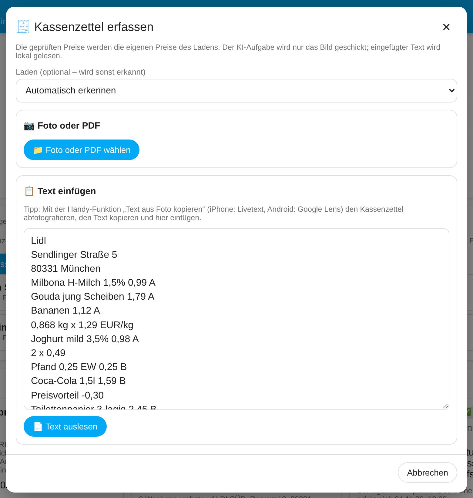 | 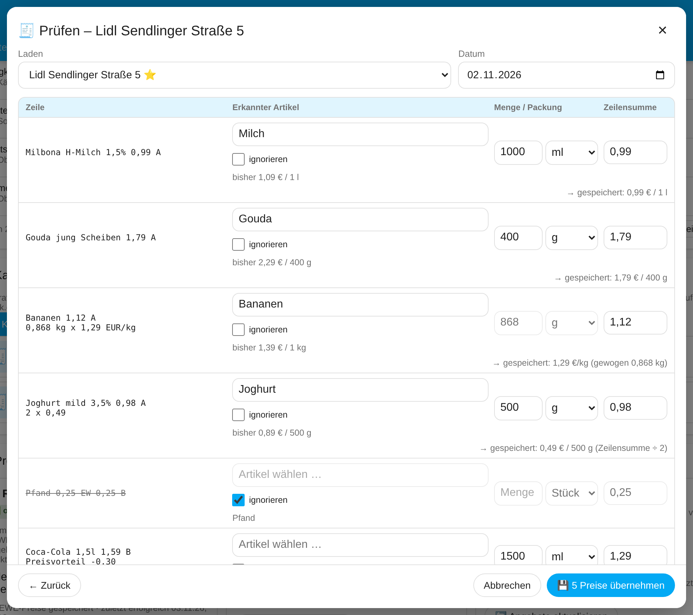 |

Im Panel: **🏪 Läden & Preise → 🧾 Kassenzettel** (oder „🧾 Kassenzettel“ in der Einkaufsliste) → Foto aufnehmen bzw. Foto/PDF wählen und „🤖 Mit KI auslesen“ – oder den Text einfügen (am Handy z. B. mit „Text aus Foto kopieren“). Ist keine KI-Aufgabe gewählt oder sie gerade nicht verfügbar, sagt das Panel das und bietet das Einfügen an. In der Prüfansicht wählst du je Zeile den Artikel (oder „ignorieren“), korrigierst Packung und Preis, Laden und Datum; die Summe der Zeilen wird mit der Summe des Kassenzettels verglichen. „Preise übernehmen“ speichert. Darunter stehen die gespeicherten Kassenzettel (Datum, Laden, Summe, Anzahl Preise, Foto) zum Ansehen und Löschen – mit oder ohne ihre Preise.

Gespeichert werden höchstens 200 Kassenzettel (die ältesten gehen samt Foto) in `/config/.storage/essensplaner.receipts.<entry_id>`; nicht gespeicherte Fotos werden nach einem Tag gelöscht. Löschst du einen Kassenzettel, bleiben seine Preise (außer mit „Preise entfernen“: dann gilt wieder der Preis davor – eingetippt oder von einem älteren Kassenzettel). Aktionen: `receipt_parse_text`, `receipt_scan`, `receipt_save`, `get_receipts`, `delete_receipt`; für das Panel die Websockets `essensplaner/receipts`, `essensplaner/receipt_parse`, `essensplaner/receipt_save`, `essensplaner/receipt_delete` und der Upload `POST /api/essensplaner/receipt_upload` – alle nur für Administratoren (Automationen dürfen die Aktionen nutzen).

```yaml
action: essensplaner.receipt_parse_text
data:
  text: |
    Lidl
    Lindenweg 2
    56501 Lindenau
    Milbona H-Milch 1,5%     0,99 A
    Butter                   1,69 A
    zu zahlen                2,68
response_variable: bon   # bon.items: Artikel, Preis, Packung, Zuordnung
```

## 🔒 Datenschutz
Alles bleibt lokal in Home Assistant, solange du keine Online-Funktion nutzt. Jede Online-Quelle schaltest du selbst ein (für neue Installationen sind alle aus) oder startest sie mit einem Knopf. Gesendet wird nur:

| Dienst | Einschalten (Standard) | Wann | Was |
|---|---|---|---|
| OpenStreetMap (`overpass-api.de`, ist er ausgelastet: `overpass.kumi.systems`) | Knopf „In der Nähe suchen“ | nur wenn du die Filialsuche startest | Koordinaten deiner Zonen, auf ca. 100 m gerundet |
| EDEKA (`www.edeka.de`) | ⚙️ → EDEKA-Angebote (aus) | täglich, Knopf „Preise aktualisieren“ | Markt-ID deiner EDEKA-Filiale; dein Browser lädt die Angebotsbilder von `offer-images.api.edeka` |
| EDEKA (`www.edeka.de`) | Knopf „🔎 EDEKA-Markt suchen“ | nur auf Knopfdruck | Postleitzahl |
| ALDI SÜD (`api.aldi-sued.de`) | ⚙️ → ALDI-SÜD-Preise (aus, experimentell) | wöchentlich und zu den Angebotsabrufen, Knopf „Preise aktualisieren“, Artikelsuche | Filialnummer und Suchbegriffe; einmal die Koordinaten deiner ALDI-Filiale (auf ca. 100 m gerundet) bzw. von Zuhause (auf ca. 1 km gerundet), um die nächste Filiale zu finden; dein Browser lädt die Produktbilder der Wochenangebote von `dm.emea.cms.aldi.cx` |
| ALDI SÜD (`www.aldi-sued.de`) | ⚙️ → ALDI-SÜD-Preise (aus), nur ohne die marktguru-Prospekte aller Filialen | höchstens einmal am Tag, wenn die Prospektliste fällig ist (etwa 2× pro Woche) | nichts außer der Abfrage der Prospektseite; dein Browser lädt die Titelbilder von `dm.emea.cms.aldi.cx` |
| ALDI SÜD (`api.aldi-sued.de`) | Knopf „🔗 ALDI-Filiale verknüpfen“ | nur auf Knopfdruck | Koordinaten der Filiale (ca. 100 m) bzw. von Zuhause (ca. 1 km) |
| REWE (`www.rewe.de`) | ⚙️ → REWE-Onlinepreise (aus, experimentell) | wöchentlich, Knopf „Preise aktualisieren“, Artikelsuche | Markt-ID und Suchbegriffe; dein Browser lädt die Produktbilder (Artikel, Einkaufsliste, Artikelsuche) vom Bildserver von REWE |
| REWE (`www.rewe.de`) | Knopf „🔎 Markt suchen“ | nur auf Knopfdruck | Postleitzahl |
| marktguru.de | ⚙️ → marktguru-Angebote (aus, eigenes Risiko) | Prospekte deiner Läden etwa 2–3× pro Woche (mit „Prospekte aller Filialen“ zusätzlich je Postleitzahl und Branche die Prospektliste), Live-Suche, Artikelsuche | Postleitzahlen (Filialen bzw. Einstellungen), Ketten und Suchbegriffe – auch, was du in „Artikel hinzufügen“ tippst (ab 3 Zeichen); dein Browser lädt die Angebots- und Prospektbilder von `cdn.marktguru.de` |
| deine KI-Aufgabe (AI Task) | ⚙️ → Kassenzettel → KI-Aufgabe (keine; sonst die KI aus ⚙️ → 🤖 KI, wenn sie eine KI-Aufgabe ist) | nur wenn du bei einem Kassenzettel-Foto „🤖 Mit KI auslesen“ wählst | nur das Bild des Kassenzettels |
| deine KI (KI-Aufgabe oder Gesprächsagent) | ⚙️ → 🤖 KI (keine) | nur auf Knopfdruck („🤖 …“ im Panel, „Verbindung testen“) | Rezeptnamen, Tags, Zutaten, Kettennamen, Angebotspreise, Monat, Gästezahl, ausgeschlossene Zutaten – siehe [KI über Home Assistant](#-ki-über-home-assistant-optional) |
| die Rezept-Webseite | Rezept-Import per Link | nur wenn du ein Rezept importierst | Abruf der angegebenen Seite |
| Bild-Link eines eigenen Artikels | „＋ Eigener Artikel“ mit Bild-Link | wenn das Panel den Artikel zeigt | dein Browser lädt das Bild von der angegebenen Adresse (Home Assistant selbst ruft nichts ab) |

Alle Abfragen senden die ehrliche Kennung `HA-Essensplaner/1.5 (+https://github.com/tollzockt/HA-Essens-planer-)`; Bot-Prüfungen und andere Schutzmechanismen werden nicht umgangen – lehnt eine Kette ab, pausiert der Essensplaner.

**Kassenzettel:** Fotos und PDFs bleiben in einem eigenen Ordner deiner Home-Assistant-Installation (`/config/.storage/essensplaner_receipts/`, nicht im Medienordner) und sind nur für Administratoren sichtbar, eingefügter Text wird lokal gelesen. Eine KI bekommt ein Bild nur, wenn du selbst eine KI-Aufgabe gewählt hast und „Mit KI auslesen“ antippst. Achtung: Die KI-Aufgabe kann ein **Cloud-Dienst** sein (z. B. OpenAI oder Google) – dann geht das Foto des Kassenzettels an diesen Anbieter; eine lokale KI wie Ollama bleibt im Haus. Mit der Integration werden auch alle Kassenzettel und ihre Fotos gelöscht (andere Dateien nicht).

Daten © OpenStreetMap-Mitwirkende (ODbL). In den Diagnose-Daten sind Koordinaten, Straßen, Postleitzahlen, Orte, Namen, Bezeichnungen, Entfernungen, Zonen-Namen, Filial- und Markt-IDs geschwärzt; übrig bleiben Kette, Hauptladen-Markierung und Anzahlen (vom Angebotskatalog, der Artikel-Datenbank und den Kassenzetteln nur Anzahlen).

## 🧩 Blueprints

| Blueprint | Was er macht | Import |
|---|---|---|
| **Erinnerung ans Essen** | Zur gewünschten Uhrzeit Push-Nachricht und/oder Sprachausgabe („Heute zum Abendessen gibt es Lasagne – das dauert etwa 90 Minuten.“) | [](https://my.home-assistant.io/redirect/blueprint_import/?blueprint_url=https%3A%2F%2Fgithub.com%2Ftollzockt%2FHA-Essens-planer-%2Fblob%2FHEAD%2Fblueprints%2Fautomation%2Fessensplaner%2Ferinnerung.yaml) |
| **Wochen-Routine** | Einmal pro Woche freie Mahlzeiten füllen, die Einkaufsliste erstellen und eine Zusammenfassung schicken | [](https://my.home-assistant.io/redirect/blueprint_import/?blueprint_url=https%3A%2F%2Fgithub.com%2Ftollzockt%2FHA-Essens-planer-%2Fblob%2FHEAD%2Fblueprints%2Fautomation%2Fessensplaner%2Fwochenroutine.yaml) |

## Entitäten

| Entität | Inhalt |
|---|---|
| `sensor.essensplaner_today` / `_tomorrow` | Geplante Gerichte; Attribute je Mahlzeit (`fruehstueck`, `mittagessen`, `abendessen` …) und die Anlässe des Tags (`occasions`), Bild als Entity-Picture |
| `sensor.essensplaner_next_meal` | Nächste Mahlzeit mit Zutaten (auf Portionen skaliert) und Zubereitung |
| `sensor.essensplaner_next_occasion` | Nächster Anlass („Filmabend“) mit Datum, Uhrzeit, Gästen, Gängen und geschätzten Kosten |
| `sensor.essensplaner_week_plan` | Anzahl geplanter Mahlzeiten (7 Tage), Plan als Attribut `days` / `summary` |
| `sensor.essensplaner_recipes` | Anzahl Rezepte; Namen, Favoriten, Kategorien |
| `calendar.essensplaner_meal_plan` | Alle Mahlzeiten und Anlässe als Termine (Termine anlegen/löschen plant bzw. entfernt Mahlzeiten; „Anlass: …“ plant einen Anlass) |
| `todo.essensplaner_shopping_list` | Die Einkaufsliste |
| `button.essensplaner_create_shopping_list` | Einkaufsliste für die nächsten 7 Tage erstellen |
| `button.essensplaner_auto_plan_week` | Freie Plätze der nächsten 7 Tage automatisch füllen |
| `sensor.essensplaner_week_cost` | Geschätzte Kosten des Plans dieser Woche (€), Budget, Kosten je Tag |
| `sensor.essensplaner_budget_remaining` | Restbudget der Woche (€) |
| `sensor.essensplaner_offers` | Anzahl aktueller Angebote, die zu deinen Rezepten passen; Top-Angebote als Attribut |
| `sensor.essensplaner_shopping_stores` | Anzahl Läden mit offenen Artikeln; Attribut `stores` je Laden mit offenen Artikeln, Zwischensumme, Ersparnis und Artikeln, dazu `main_store` |
| `sensor.essensplaner_shopping_total` | Geschätzte Summe der offenen Einkaufsliste (€); Artikel mit/ohne Preis, Angebote, Ersparnis durch die Ladenwahl |

## Aktionen (Services)

Alle Aktionen liefern optional eine Antwort (`response_variable`) und verstehen natürliche Datumsangaben.

| Aktion | Zweck |
|---|---|
| `essensplaner.add_recipe` / `update_recipe` / `delete_recipe` | Rezepte verwalten |
| `essensplaner.import_recipe` | Rezept von URL importieren |
| `essensplaner.get_recipes` / `get_recipe` | Suchen / Rezept (skaliert) abrufen |
| `essensplaner.find_by_ingredients` | Rezepte zu vorhandenen Zutaten |
| `essensplaner.plan_meal` / `remove_meal` / `get_plan` | Wochenplan (optional mit Getränken zur Mahlzeit) |
| `essensplaner.move_meal` / `copy_plan` | Verschieben/Tauschen, Wochen kopieren |
| `essensplaner.suggest_recipes` / `auto_plan` | Vorschläge (mit Gründen: ⭐, 🍂 Saison, 🏷️ Angebot) / automatisch planen (Planungsart auch `seasonal`; `ai: true` lässt die KI die besten Rezepte ordnen) |
| `essensplaner.generate_shopping_list` / `get_shopping_list` | Einkaufsliste erzeugen (mit Läden und den Anlässen dieser Tage, oder nur für einen Anlass) / abrufen (optional nur ein Laden) |
| `essensplaner.add_shopping_item` | Artikel mit Laden und Preis auf die Einkaufsliste setzen (auch ein Angebot aus „Alle Angebote meiner Läden“ per `offer_id` oder ein Produkt der Artikel-Datenbank per `product_id`) |
| `essensplaner.set_shopping_store` / `assign_shopping_stores` | Laden für einen Artikel festlegen („immer hier“) / alle offenen Artikel neu zuordnen |
| `essensplaner.mark_cooked` | Als gekocht merken (bessere Vorschläge) |
| `essensplaner.export_recipes` / `import_recipes` | Backup & Teilen |
| `essensplaner.import_starter_recipes` | Fehlende mitgelieferte Rezepte (176) ergänzen |
| `essensplaner.clear_shopping_list` | Einkaufsliste leeren (alle / erledigte / aus dem Plan) |
| `essensplaner.get_costs` | Kosten & Restbudget (mit den Anlässen) |
| `essensplaner.set_price` | Eigenen Preis für eine Zutat festlegen (optional für einen Laden) |
| `essensplaner.get_store_prices` / `compare_prices` | Preisliste je Laden / Preis eines Produkts in deinen Läden vergleichen |
| `essensplaner.find_branches` | Filialen bei OpenStreetMap suchen (Zonen, Umkreis, Arbeitsweg) |
| `essensplaner.save_branch` / `remove_branch` / `get_branches` | Filialen anlegen/ändern (auch `rewe_market_id`, `edeka_market_id`, `aldi_service_point`), entfernen, abrufen |
| `essensplaner.refresh_prices` | Preise jetzt aus einer Online-Quelle holen (`offers` = Angebote deiner Läden, `rewe` = REWE-Onlinepreise, `aldi` = ALDI-SÜD-Onlinepreise, `edeka` = Angebote deines EDEKA-Markts) |
| `essensplaner.find_rewe_markets` | REWE-Märkte und ihre Markt-IDs zu einer Postleitzahl finden |
| `essensplaner.find_edeka_markets` | EDEKA-Märkte und ihre Markt-IDs zu einer Postleitzahl finden |
| `essensplaner.find_aldi_stores` | ALDI-SÜD-Filialen und ihre Filialnummern in der Nähe finden (Koordinaten, Postleitzahl einer deiner Filialen oder die ALDI-Filiale) |
| `essensplaner.refresh_offers` / `get_offers` / `search_offers` | Angebote deiner Läden laden (höchstens einmal pro Stunde), abrufen, live suchen |
| `essensplaner.add_offer` / `remove_offer` | Angebot eintragen / löschen |
| `essensplaner.get_leaflets` | [Prospekte deiner Filialen](#-prospekte-aller-filialen) abrufen (Seitenbilder, Gültigkeit, Link; optional nur eine Kette oder Filiale) |
| `essensplaner.receipt_parse_text` / `receipt_scan` | Kassenzettel-Text lokal lesen / Foto oder PDF von der KI-Aufgabe lesen lassen (Vorschlag zum Prüfen) |
| `essensplaner.receipt_save` / `get_receipts` / `delete_receipt` | Kassenzettel speichern (Preise werden eigene Ladenpreise) / abrufen / löschen |
| `essensplaner.search_products` / `save_product` | In der [Artikel-Datenbank](#-artikel-datenbank) suchen / eigenen Artikel anlegen oder ändern |
| `essensplaner.save_occasion` / `delete_occasion` / `get_occasions` | [Anlässe](#-anlässe--getränke) planen oder ändern / löschen / abrufen |
| `essensplaner.suggest_occasion_menu` / `suggest_drinks` | Menü für einen Anlass vorschlagen (optional mit KI, auf Wunsch übernehmen) / Getränke zu Gericht oder Anlass vorschlagen |
| `essensplaner.set_shopping_product` | [Produkt eines Artikels der Einkaufsliste wechseln](#-einkaufsliste-aus-der-artikel-datenbank) (optional als gewählt oder ⭐ Lieblingsprodukt merken) |

```yaml
action: essensplaner.plan_meal
data:
  date: morgen
  meal: abendessen
  recipe: Lasagne
  servings: 4
```

```yaml
action: essensplaner.find_by_ingredients
data:
  ingredients: Hähnchen, Reis, Paprika
response_variable: ideen
```

```yaml
action: essensplaner.get_shopping_list
data:
  store: Aldi Süd   # oder "Hauptladen", "Lidl Arbeit", "Rossmann"
response_variable: einkauf   # einkauf.selection: Artikel, Zwischensumme, Ersparnis
```

Weitere Beispiele: [`examples/automations.yaml`](examples/automations.yaml).

## Daten
Alles wird lokal in `/config/.storage/essensplaner.<entry_id>` gespeichert (auch die Anlässe; die Angebote deiner Läden in `essensplaner.catalog.<entry_id>`, die Artikel-Datenbank in `essensplaner.products.<entry_id>`, die Kassenzettel in `essensplaner.receipts.<entry_id>` und ihre Fotos in `/config/.storage/essensplaner_receipts/`) und ist Teil der normalen Home-Assistant-Backups. Das Event `essensplaner_updated` wird bei jeder Änderung ausgelöst. Für die Fehlersuche gibt es Diagnose-Daten (Gerät → ⋮ → Diagnosedaten herunterladen) – ohne Koordinaten, Adressen (Straße, Postleitzahl, Ort), Namen und IDs deiner Filialen; auch die Postleitzahl aus den Einstellungen ist geschwärzt.

## Entwicklung

```bash
pip install -r requirements_test.txt
pip install hassil home-assistant-intents  # Versionen passend zu components/conversation/manifest.json
pytest
```

Änderungen: [CHANGELOG.md](CHANGELOG.md) · Lizenz: MIT
